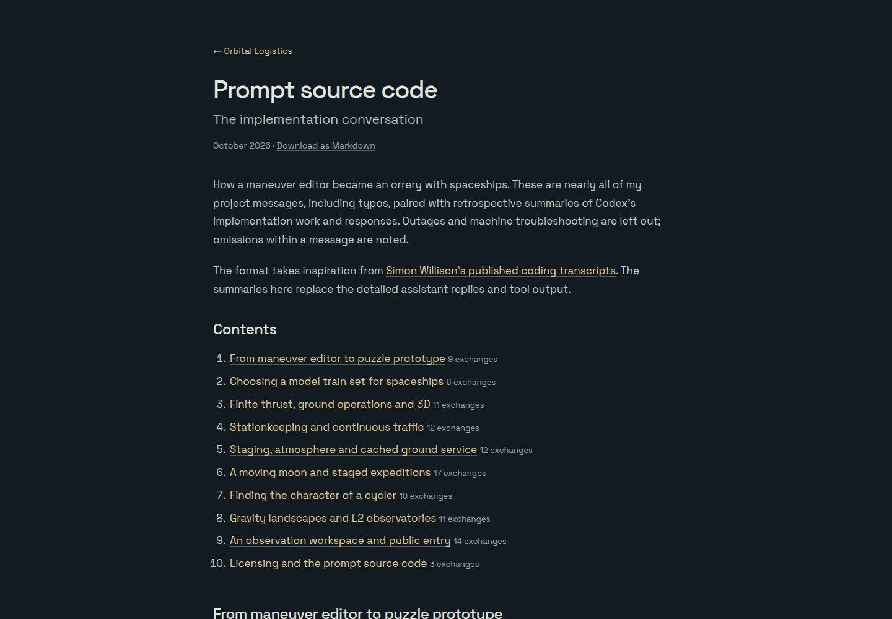
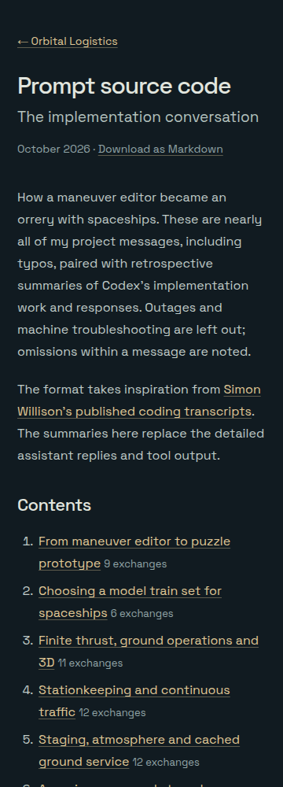
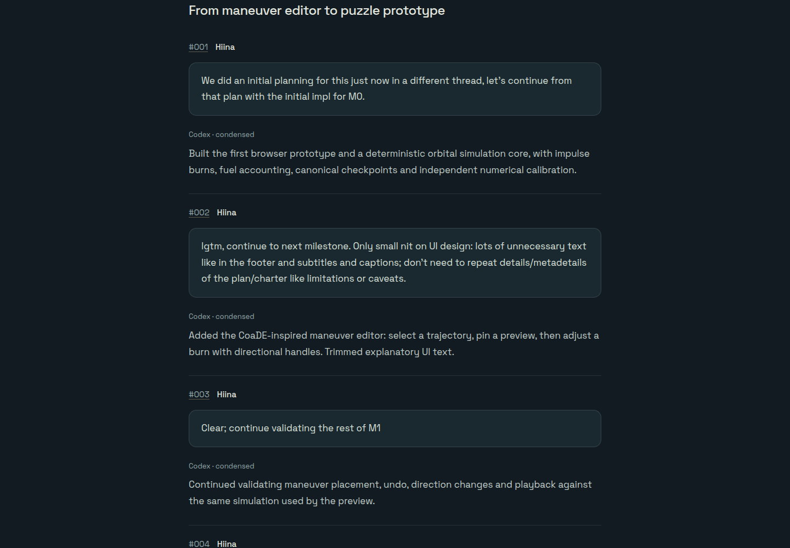

# Public build transcript

`transcript.json` is the manually reviewed public content source. It includes nearly
every project message from the implementation conversation, including small UX
requests and unsuccessful iterations. It starts with M0, after the initial planning
conversation, and currently ends with licensing and this transcript’s presentation.

The earlier portion was extracted from the owner's implementation-session records;
the continuation was transcribed from owner messages available in the ongoing chat.
Ambient UI state, injected instructions, tool payloads, private reasoning, outages,
machine troubleshooting and personal account/quota passages are excluded. Partial
message omissions are labeled. Owner wording and typos are retained; whitespace and
links are formatted for reading. The Codex paragraphs are retrospective summaries,
checked against the project evidence and visible implementation responses rather
than presented as verbatim assistant replies. No raw session files are shipped.

`scripts/build-log.ts` renders the source into the `build-log/index.html` entry at
development/build time and emits `build-log.md`. The source stays out of the viewer
and landing dependency graphs. There is no client transcript renderer, analytics,
third-party embed or new package dependency. Both formats are readable without JS.
The dev server watches the JSON and reloads the transcript page after an edit.

The structure follows the numbered prompts and navigable index of
[Simon Willison's transcript publisher](https://simonwillison.net/2025/Dec/25/claude-code-transcripts/),
with short summaries replacing detailed assistant/tool output. No code or transcript
content was copied from that project.

## Validation

All105 numbered exchanges render in production without JavaScript. The six-case
entry suite covers the chapter links, complete Markdown export, narrow-screen
layout and plain static subdirectory navigation. Desktop and narrow viewport
screenshots were inspected. The page does not load the viewer, workers or fixtures.

October15: owner messages have a rounded panel background and border to distinguish
them from the plain condensed Codex responses. The content and summaries are unchanged.

