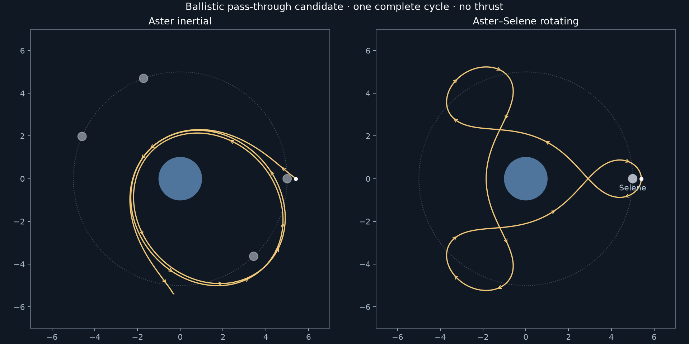

# Pass-through carrier research — 2026-10-12

The owner accepted this plot. The subsequent [finite service implementation](../redesign/README.md)
adds the parking/phasing and surface legs; the research record below predates that work.

The owner rejected the refined compact cycler: Wayfarer still turns around to
rendezvous with Beacon, and Pipit's shallow surface approach lacks an orbital phase.
The existing profile remains available, but its aesthetic gate is **not accepted**.
This round changes no application code or public fixture.

## Diagnosis and precedents

Verified in `src/compact/prepare.ts`: each cycle begins/ends with carrier Beacon
support, paid capture and funded refill. Shortening those burns still requires
matching the stationary rotating equilibrium. That is the structural source of the
powered turnaround; the earlier refinement optimized around the wrong constraint.

The owner's [discussion](https://space.stackexchange.com/questions/66520/does-a-lunar-cycler-make-practical-sense)
raises the useful distinction between a large coasting carrier and smaller vehicles
that pay for rendezvous and landing. Its practical/economic conclusions are commentary,
not a numerical design certificate. A carrier does not have to make a direct taxi
mathematically impossible to have a distinct role in a model set.

Primary references:

- [Genova and Aldrin, 2015](https://ntrs.nasa.gov/citations/20150018049): corrected
  free-return cycles, lunar flybys and intervening Earth holding orbits. A carrier need
  not stop at an L2 station; smaller craft can transfer there separately.
- [Wittal et al., 2022](https://ntrs.nasa.gov/citations/20220013595): resonant families
  have different access/maintenance tradeoffs. Their lunar landing architecture uses
  flyby targeting, orbital circularization and descent; the paper excludes final
  descent from its tabulated transfer cost. These are ideas, not copied numerical
  parameters for the fictional field.

## Bounded numerical result

The field is unchanged: fixed Aster GM1/radius1, prescribed Selene GM.03/radius.2
at radius5, angular rate√(1.03/125), no indirect term. Rotating-frame equations are
therefore autonomous but are not the barycentric circular restricted problem.

Symmetric half-orbit shooting and axis-crossing bracketing found a candidate with
rotating initial state `[5.4,0,0,-0.42847216402520905]` and period
`120.50467632722804`. Independent full-period closure is approximately6.85e-12.
It starts already in flight. There is no Beacon stop, thrust, capture, fuel reset or
re-initialization at a period boundary.

The native check propagates **three complete periods** from actual preceding
endpoints, splitting solely to respect the existing≤80-unit trace interval limit.
Aster minimum center distance1.852666, Selene minimum0.400000, maximum Aster radius
5.708526. Surface clearances are therefore approximately.853/.200. Native enclosure
checks cover the complete intervals; the initial authoring search only used sampled
clearance and is not that safety certificate.

At1/512 the complete three-period horizon uses185100 physical nodes/enclosure checks,
within the current240k/400k baseline aggregate envelope. Independent rotating DOP853
propagation agrees at385 query epochs to maximum position1.21e-9 and velocity4.25e-10.
Half/quarter-step reruns also stay below1e-8 agreement; each calibration has a separate
bounded800k-node/check budget, not a change to production guards. Closure at period3
is1.62e-9 position/7.05e-10 velocity at the baseline step. Nonmonotonic residuals at
this small scale do not establish indefinite stability or an asymptotic convergence
order. Long-time stability, perturbed targeting and taxi feasibility remain untested.

The plot is one actual independently integrated circuit. Inertial start/end do not
coincide: the recurring shape rotates with Selene. Rotating-frame petals and apparent
turning are natural orbital motion here, with zero thrust. The paper's named cycler
families are not asserted to be identical to this fictional candidate.

## Next implementation gate

Astra's reviewed recommendation is a **finite carrier-only viewer**, two circuits
and an optional third. Keep masses/radii/separation fixed initially. The candidate
above clears the numerical research gate, not the integrated viewer/owner taste gate.
Use a new definition/version rather than relaxing legacy profile rules.

For this candidate, record an explicit viewing envelope: Aster encounters at center
radii1.2–2.2, Selene encounters.25–1.3; outward extension beyond5 is a chosen display
preference. Those ranges are a post-search selection envelope, not pre-registered
optimization evidence. This candidate's correction budget is zero; if another branch
needs corrections, declare a finite paid budget relative to circular speed at radius2
(1/√2), before accepting it. Do not silently strengthen engines again.

After viewing the carrier, author one directional Pipit connection with a genuine
Aster parking coast and separately inspect its terminal descent. A parking orbit
alone does not guarantee a satisfying landing angle. Select pad longitude/descent
entry geometry deliberately; keep endpoint safety/paid velocity matching. Decide on
one reusable taxi versus separate ground taxis only when encounter windows are known.

Continuous migration follows later: small closure residuals cannot justify modulo
resetting a free spacecraft. Arbitrary periods do not preserve the absolute RK4 grid;
correct position/velocity drift physically or bound it, retain fuel/mass changes and
funded replenishment, and replace the current carrier-dock-based trip counter.
L1/halo/Lissajous exhibits remain a separate future set.

## Reproduction and retained scope

Use `uv run --project spikes/numerics python` for `search.py` (default, `--family
outer`, `--family resonant`), `continuation.py`, and `crossings.py`. These have bounded
trials/calls and reject collisions/nonconvergence; failure is not proof that other
families cannot exist. `continuation.py` sometimes jumps families, so its output is
exploratory roots, not a verified continuous branch.

`crossings.json` is the selected-candidate catalogue. `validate.ts` selects its first
both-body candidate. `oracle.py` uses the frozen candidate in `native.json` and writes
an uninterrupted independent three-period witness; run `npx tsx .../validate.ts` after
that to reproduce agreement. The retained native.json also bootstraps the initial
oracle. `plot.py` runs with `uv run --project spikes/numerics --group plots python`.
No large native traces or worker/display caches are retained. Candidate catalogues,
small oracle, numerical summaries and design review are permanent research evidence.
