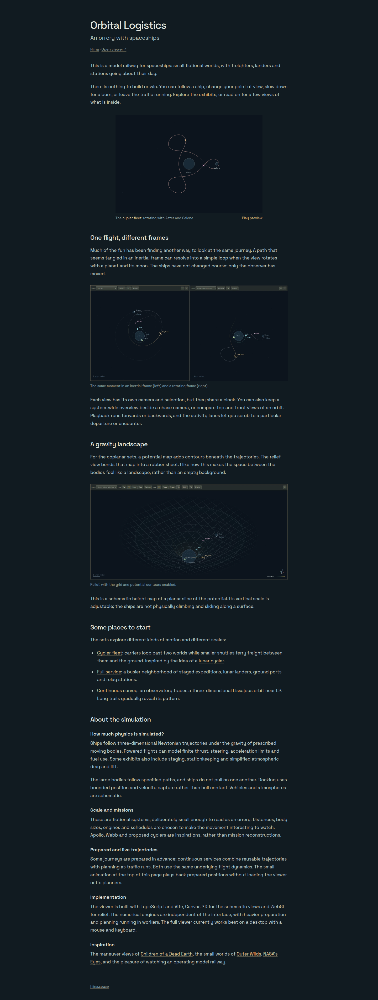
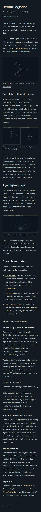
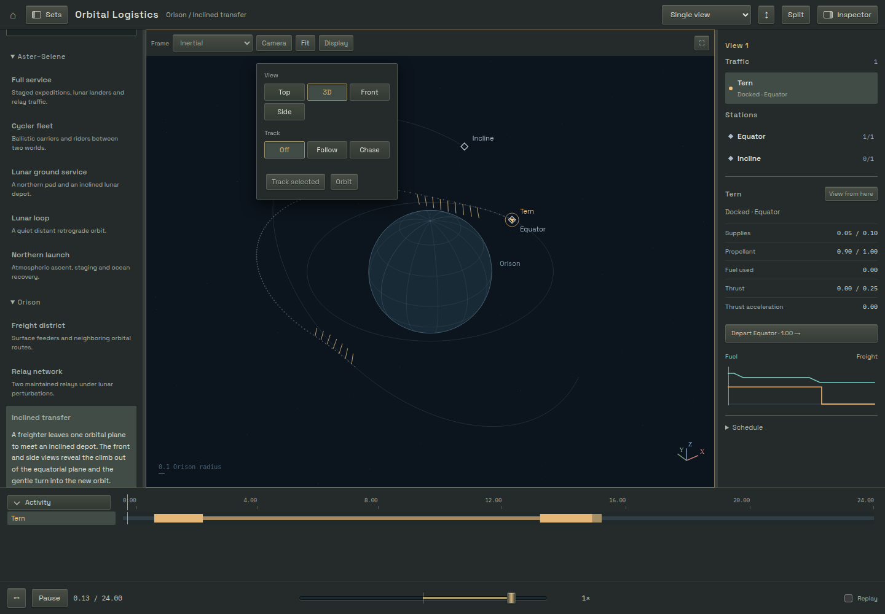

# Public entry

The root page is a linear project article: title/byline, a small cycler animation,
paired-frame and relief screenshots, exhibit links, and open simulation notes.
There are no feature cards, promotional navigation bars or FAQ accordions. The
single reading column is752px wide at desktop sizes; the animation is capped
at560px. Space Grotesk and the viewer's palette keep the two pages related without
copying the workspace's panel controls. Copy in `index.html` remains a draft for
the owner to rewrite before publication.

The article is readable without JavaScript. Both viewer screenshots are lazy
static WebP images with reserved dimensions, alt text and full-resolution links.
They add62,110bytes combined and do not embed another running viewer. The captures
come from the current Cycler fleet at epoch20 in a1460×960 Chrome viewport, with
the sidebars collapsed and only the viewport area captured (1460×706):

- `public/images/paired-frames.webp`: Inertial + Rotating layout, both Top cameras.
- `public/images/gravity-relief.webp`: single rotating frame, relief gain1.8, grid
  and potential layers enabled, default oblique camera.

PNG captures were encoded as WebP at quality90 without compositing or altering
the rendered scene. The desktop/narrow page images below show their placement.

## Loading and lifetime

The implementation follows Vite's multi-page entry pattern. `/` and `/viewer/`
are separate documents and dependency graphs. The root page never imports the
viewer registry, numerical engines or worker bootstraps. A full navigation owns
each page's lifetime. Pagehide disposes the preview/workspace; a BFCache restore
reloads the relevant document rather than exposing disposed canvases or sessions.
Simulation persistence while reading the article is intentionally unnecessary.
No framework router, backend or third-party font/image host is required.

`npm run prepare:landing` creates `src/landing/preview.json` and
`public/orbital-preview.svg` from the admitted recurring cycler profile. The
existing canonical preparation checks its independent oracle before481 position
samples per carrier are rounded for disposable display. The two-carrier clip is
16,555bytes of JSON, with a verified rotating-frame loop seam. It is a repeating
illustration, not continuous resource execution. The source artifact and numerical
code are build-time inputs only; the browser module contains just frozen points
and a minimal Canvas drawing loop.

The optional enhancement renders at most20fps, caps DPR/backing width, pauses when
out of view or in a background document, offers Play/Pause and honors reduced
motion. Reduced-motion arrivals retain the SVG without downloading the animation
module until Play. The poster reserves its aspect ratio so enhancement cannot
change layout height. Resizing does not restart simulation because there is none.

## Validation, 2026-10-14 editorial revision

- `npm run build` passes strict TypeScript and produces both HTML documents.
- All five production entry browser cases pass: unloaded viewer/fixtures/workers,
  animation pause/offscreen behavior, no-JS/reduced-motion at360px, lazy image
  loading, viewer navigation/back/forward, native camera radios and static hosting
  under `/collection/`.
- A1440px desktop article visit, followed by scrolling both figures into view,
  fetched21,321decoded bytes of JavaScript,2,522bytes CSS,12,210bytes SVG,
  23,060bytes local font and62,110bytes WebP. Including HTML, the complete article
  is approximately131KB decoded. These are local resource measurements, not
  network field percentiles.
- The installed Firefox156 isolated-profile smoke passes the article animation
  and existing viewer controls, dropdown stability and field/relief checks.
- Desktop and360px browser screenshots were inspected; neither has horizontal
  overflow. No real-phone, deployed-domain, certificate or Cloudflare header
  result is claimed.
- The previous scaffold's21-case workspace/entry validation remains historical;
  this revision changes only the article, its illustrations and entry assertions.

The read-only [Pages investigation](../../deployment/cloudflare-pages.md) records
publishing prerequisites. No production changes were authorized or performed.

## Viewer controls from the initial entry slice

Camera View/Track controls are native radio groups with per-pane names, styled as
exclusive button panels. Compact menus expose every option immediately; wide views
use those same controls inline. Native arrow keys stay within their own group.
Surface retains its deliberate framing behavior and tracking retains its own
locked target. The article revision does not change these controls.

