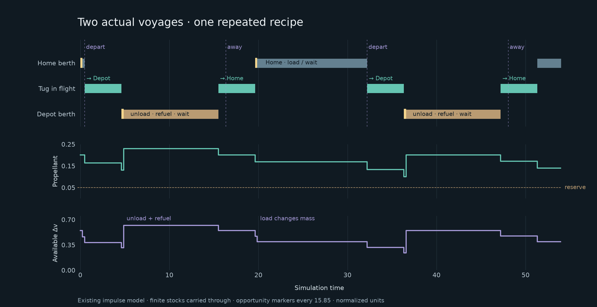

# Periodic transfer programming — design study, 2026-10-07

**Subsequent design reconsideration:** the user questioned the construction-game
premise and requested OpenTTD research plus an independent Astra consultant.
The [topology study](../topology-study/proposal.md) now recommends a finite
three-port courier probe before this recipe/timeline slice. This document retains
the reviewed semantics and evidence; its immediate sequencing recommendation is
deferred pending user design review. No recipe/timeline was implemented.

Status: reviewed proposal, not yet user-approved for implementation. Astra ran
as `gpt-6-astra`, xhigh, with successful CLI transport verified before synthesis;
see [review](astra-review.md) and [disposition](review-disposition.md).
This document proposes the next prototype;
`src` still implements absolute impulses/operations. The user accepted the
CoaDE-like rendezvous interaction and requested this design study before further
implementation. Horizontal activity lanes, visible budget history and compelling
looping choreography are explicit user priorities. Departure/docking bookkeeping
is an observed usability problem, not a request for more precision controls.

## Recommendation

Author a small **service recipe**: service at Home → transfer to Depot → service
at Depot → transfer Home → repeat. Show it as an unwrapped horizontal timeline
with one lane per ship and optional port lanes. A transfer owns its departure,
coast, arrival matching and capture; the player edits the relationship rather
than separately maintaining contradictory burn/dock timestamps. Expand any block
to inspect the resulting paid maneuvers in the existing spatial editor.

The player owns itinerary, cargo/refueling amounts, departure phase/window,
flight duration, trajectory family and fleet cadence. A deterministic local helper
calculates numerical burn components within that contract. It does not select a
different itinerary, departure opportunity or encounter branch to make a failed
program succeed. Keep generous impulsive propulsion available; separately test
finite thrust before choosing a permanent propulsion regime.

The smallest useful next build is one tug, two ports and two actual voyages,
with state-dependent recipe compilation, a timeline and resource traces. Then
compare propulsion regimes before adding the second ship and a shared
berth/handoff. These are gates,
not a commitment to a campaign, arbitrary scripting or an infinite simulator.

## What repeats

| Concept | Contract |
| --- | --- |
| Recipe | Same named actions re-executed against the real state of each voyage. |
| Opportunity | A selected relative-phase crossing/window can recur. Its interval need not equal the round-trip duration. |
| Physical recurrence | Ship/environment state returns, possibly up to a common rotation in a symmetric fixture. Resources also need explicit replenishment for sustainability. |
| Replay loop | A presentation that restarts a recorded run; it earns no extra deliveries and grants no simulation resources. |

Begin with a **finite batch**: deliver two loads and return empty with a reserve.
Include startup and the final return in completion time and gross propellant
consumption. A later sustained-service puzzle specifies its evaluation interval,
delivery cadence, inventory sources/sinks and terminal obligations explicitly.
Two successful trips demonstrate reuse, not indefinite sustainability. Never
reset inventory or ship fuel at a loop seam.

### Existing-fixture experiment

Reproduce with `npx tsx scripts/periodic-study.ts`. The unchanged runner executes
two explicit copies of the patient flight legs, retaining inventories and using
identical service quantities. Home reload begins at the first return. This is
a scheduling study, not a recipe compiler or runtime
intent implementation. [Raw measurements](schedule-study.json) include the ledger.

- Relative angular rate gives `S = 2π / (1 − 0.6036816105203691) = 15.853883`.
- First outbound departure is 0.5; the next identical relative geometry is
  16.353883. The tug returns at 19.626757, too late for it.
- Reuse at `2S = 31.707766` gives second departure 32.207766 and return
  51.334523. Both loads deliver: 0.4 cargo, 0.259748 gross propellant consumed,
  0.140252 fuel remaining aboard. No special second-voyage refueling is needed.
- Copying the same burns immediately on returning Home misses Depot by about
  1.90 length units. This does not disprove a newly targeted early departure.
- h/h2 both complete; final fuel differs by less than 9e-13. Varied scrub/advance
  partitions reproduce state and ledger exactly. No new independent oracle was
  run: this reuses the previously calibrated impulse dynamics and circular ports.

The recurring geometry is rotated in inertial space; it is not a claim that all
planet coordinates reset. A second staggered tug could potentially use the
intervening opportunity, but hardware/occupancy feasibility has not been tested.
Both retained M4 patient/express routes miss the next cheap outbound opportunity;
their completion-time tradeoff does not establish different repeat cadences.
Identical impulse components work at this repeated geometry because commanded
velocity changes and gravitational paths are mass-independent in the current
model; actual mass still changes fuel accounting and affordability.

Regenerate with `uv run --project spikes/numerics --group plots python
scripts/periodic-study-plot.py`. This is an evidence diagram, not implemented
timeline UI. Fuel/Δv curves come from actual ledger events; there is no invented
porkchop surface. The optional plotting dependency is locked in the numerical
tools' `plots` group and does not enter the browser bundle.

## Authoring and timeline

Keep the viewport for spatial reasoning and the timeline for temporal reasoning.
They share a scrub cursor and selection. Timeline time is physical time, not an
instruction count. Distant coasts can be zoomed; collapsing repeated motifs is
a view operation with visible elapsed duration, never a change to the simulation.

| Block | What the player edits | Visible result |
| --- | --- | --- |
| Port service | Cargo quantity, fuel quantity or fill target, optional later handoff dependency | Docked interval, completion, inventory changes; departure waits for completion. |
| Transfer | Destination, selected departure opportunity/window, flight duration, family/branch, correction bounds/reserve | Undock, paid departure, coast, paid arrival/capture; current resolved epochs/cost. |
| Derived wait | No independent timing control | Interval between service readiness and committed departure; occupies berth. |
| Manual flight | Explicit burns/event-relative offsets in a named basis | A low-level block requiring validation on every execution; no implied tracking autopilot. |

Use two related views: an editable compact recipe and its resolved, unwrapped
occurrences. Every occurrence carries `(shipId, recipeId, voyageIndex, blockId)`.
Editing either occurrence edits the recipe and regenerates both voyages as a new
draft. Accepted execution remains immutable. Defer individual occurrence overrides
until there is an actual authoring need; generated burns are not the recipe.

Drag a transfer horizontally to change departure; drag its right edge to change
duration. The destination service follows arrival; later authored departures
remain fixed. If readiness moves past one, show a conflict rather than silently
moving that departure. Deadlines/handoffs likewise retain their identities.
During dragging, retain the last complete path as visibly stale; resolve on
settling, keep undo atomic. Hover anywhere on either view scrubs the same bodies.

Suggested visual vocabulary: small service blocks, translucent waits, thin coast
blocks with departure/arrival diamonds, restrained color per ship. Expandable port
lanes show occupancy and future handoff lines. Use a single failure badge at the
first blocked block, with detail on selection. Do not add charter text/caveats to
the ordinary canvas/footer. Loop replay can continue using bodies/trails-only.

### Departure rules and conflicts

For the first circular two-port fixture, each leg has first departure `d_leg`
and duration `τ_leg`; voyage `v` departs at `d_leg + v·k·S`, with a shared positive
integer `k` and geometry-derived synodic period `S`. The player chooses each leg's
phase by moving its first departure and chooses cadence with `k`. The outbound
and return departures are independently committed within each voyage. Service
starts on attachment and waiting is derived from its completion. Initial attachment
and final stopping are outside the repeated body. `k=1` must identify the second
outbound departure at 16.353883 as conflicting with return/reload readiness;
`k=2` works for the patient witness. This is a fixture-specific timing rule,
not an assertion that arbitrary multi-body worlds or torchships require such a clock.

A later phase rule can name source/target, crossing direction, phase value,
occurrence/every-kth opportunity, earliest arming epoch and bounded latest departure.
Use a shared phase origin, not an opportunity count reset whenever a tug is ready.

At the selected departure, require completed service, cargo/fuel and a valid
resolved transfer. Default missed-window behavior is a visible block. An authored
“next same opportunity, within X” policy may follow; it cannot silently switch
branch or optimize another window. Docked waiting follows the port rail and
occupies the berth. Waiting in flight continues gravity and must name an actual
coast/holding trajectory; there is no stationary pause in space.

For joint programs, future arrival reservations are schedule commitments, not
physical docking. Validate both planned occupancy and live capture; release a
berth only when the ship actually undocks. Reserve inventory/service atomically,
scope acknowledgements to the voyage, detect dependency deadlocks and stop
downstream predictions after a failed shared action. Do not promise a universal
dispatcher; begin with two ships and one explicitly named dependency.

## Assistance and player expression

Use one assistance layer with inspectable constraints, rather than separate opaque
“easy” and “expert” physics. A transfer block names its target, departure/duration,
direction/revolutions, clearance, permitted burn variables, seed, work limit and
fuel bounds. The helper fits the components from actual departure state and
mass, and charges arrival matching. It may not move the selected dates in the
first slice. An optional narrow time-adjustment range is a later authored freedom.
Keep numerical seeds, iteration limits and implementation component bounds in
advanced diagnostics; making the user nurse convergence is not intended gameplay.
Separate resource rejection, unsupported helper domain and unresolved search.

Players can explore time/fuel tradeoffs, skip a cheap opportunity to synchronize
a later handoff, carry less reserve, refuel at another port, or use more hardware.
Low-level spatial burn editing remains valuable for designing a nonstandard
template and debugging why a family fails. Editing generated burn components
explicitly detaches that leg to manual mode; it does not preserve an invisible
dynamic promise. A later reusable manual template can combine event-relative
burns with a bounded terminal match, but must expose the terminal match's actual
cost and cannot repair an arrival-position miss with velocity alone.

“Transfer to orbit” is a separate endpoint contract: selected center, desired
orbital state at a named epoch/event, direction and allowed phase freedom. Matching
an orbit does not imply intercepting a body. Defer generic multi-body osculating
orbit targets; first reuse the port-to-port helper in its calibrated domain.

### Opportunity map

Offer a porkchop-inspired inspector for the **selected leg**. Proposed axes are
departure time (relative phase labels in the two-port case) × flight duration.
Color departure-plus-arrival propellant cost at the selected load; optional Δv
view is useful for engine-independent trajectory comparison. Fuel availability,
reserve and known occupancy overlay feasibility separately. C3 is appropriate
for some launch analyses, but is not the complete paid dock-to-dock cost here.

Hover a cell previews path, epochs and costs; clicking proposes those choices
on the timeline, with validation/undo. Start with a small bounded survey or cost
curve, not a densely optimized atlas. Start with two slices: departure cost at a
fixed duration, and duration cost at a fixed departure. Beside local fuel cost,
show return readiness and conflict/slack against the next committed departure.
The best point on a slice is not a global optimum; add the 2D map when coupled
choices actually warrant it. A cell that exceeds solver work limits is
**unresolved**, not proven physically impossible. Distinguish unresolved, rejected
and validated; never interpolate a guarantee across unsampled cells. Key results
by the actual departure prefix, load, engine, target, branch, model and bounds.
For a docked tug, a survey may derive the candidate departure state by following
the port and scheduled service; future shared actions remain conditional until
joint prediction validates them. Recompute paid full-program costs after selection.
The existing browser helper took about 0.6s in two M4 observations, so even 64
equally expensive cells could take tens of seconds. Those observations are not
a survey benchmark. Use explicit cancellation, progressive validated samples and
work limits; do not make the timeline depend on generating a dense heatmap.

## Fuel and Δv lanes

Propellant quantity is the primary conserved resource. Beside it show ideal
remaining Δv at the current load:

`Δv_available = v_e ln((m_dry + m_cargo + m_fuel)/(m_dry + m_cargo))`.

Loading cargo reduces capability; unloading increases it without creating fuel.
Refueling draws from a finite port and may increase the trace. Consequently
remaining Δv is not initial allowance minus a single monotonic “spent” number.
Keep cumulative maneuver Δv and gross propellant consumption as separate
inspectable totals. A reserve line is a player/scenario threshold; a predicted
return requirement is state-dependent and labeled as an estimate until validated.

Align fuel/cargo traces and departure windows to the ship lane and scrub cursor.
Show accepted and draft cost differences at the edited leg, plus the first future
deficit. Refueling jumps occur at service completion, matching the current atomic
model. A collapsed repeat may show its range, but detailed history uses actual
instance events. Finite thrust later changes steps to slopes during burns.

## Propulsion direction

Do not equate an impulse model with chemical-only gameplay. Current units are
normalized and `v_e=3` has no fixed SI chemical interpretation. Generous exhaust
velocity/fuel or a different mass ratio already permits faster non-Hohmann arcs.
The existing patient/express examples demonstrate one time/fuel tradeoff; they do
not establish that those alternatives are fun or that all levels avoid degeneracy.
The current helper hardcodes departure components to ±0.25, CCW and less than
one revolution. Increasing fuel/exhaust velocity alone does not expand that
targeting domain. A generous-impulse study needs a separately validated wider
domain or authored witnesses so helper restrictions do not masquerade as physics.

Acceleration and total Δv are separate design dimensions. High exhaust velocity
does not by itself imply high acceleration. A finite-thrust engine needs thrust,
mass flow and steering; constant force gives changing acceleration as fuel burns.
For constant-acceleration commands, specify throttling and a force cap. A practical
first experiment uses bounded thrust `F`, `a=F/m`, `dm/dt=−F/v_e` and a small
burn–coast–brake family, integrated with gravity. Engine mass/cost can be fixed
scenario parameters before any power/thermal subsystem exists.

Candidate steering family for the spike: constant inertial direction during each
of two powered segments, separated by a coast. For selected departure and total
duration, fit two heading angles and two burn durations to the four terminal
position/velocity constraints, with nonnegative durations and no overlap. This is
a restricted numerical experiment, not a guarantee every transfer has a solution.
Use no hidden terminal impulse. Check zero-gravity rocket motion, mass accounting,
step convergence, independent integration and gravity/surface bounds before
interpreting the result as torchship gameplay. Compare `a/(μ/r²)` and available
`Δv/√(μ/r)` to describe regimes without committing normalized units to real engines.

The linked ideal midpoint-flip calculator is useful inspiration. For a rest-to-rest
straight transfer without gravity or endpoint motion, `T=2√(D/a)` and
`Δv=2√(aD)`. It is not a solution for two moving orbiting ports. Raising impulse
fuel caps cannot validate finite-thrust trajectories or constant acceleration.

Run three bounded content comparisons immediately after the first timeline gate,
before two-ship scheduling: economical impulse, generous impulse and finite
thrust. Hold objective/geography fixed, then compare paid fuel, time,
hardware, trajectory appearance and voluntary player revisions. A torchship may
legitimately make the direct path optimal; the remaining puzzle can be cadence,
payload, depot placement and limited hardware. Whether that choreography retains
enough orbital character is a human taste gate. Do not add heat/power/cooldown
taxes solely to forbid an otherwise good direct solution. Multi-body assists,
low-thrust spirals and cyclers are later distinct experiments, not prerequisites.

## Architecture and evidence gates

Keep authored recipe, generated events and execution ledger separate. First add
a versioned **bounded recipe compiler**, not runtime event insertion. Sequentially
forward-simulate the accumulated program, resolving each of four transfers from
its own preceding physical/discrete state. Strip obsolete downstream events before
each solve. Reuse the current helper within its supported domain; extract a local
propagator only if measured cost warrants it. Validate the complete generated v1
program before accepting it; any compilation failure leaves the accepted plan intact.

The authored source is state-dependent: a new phase, duration, load or fuel policy
regenerates affected instances from their actual simulated prefixes. Resolution
happens before playback in this deterministic finite experiment. It is **not yet
runtime feedback** and does not claim an unforeseen live change can be repaired.
Save recipe/version, scenario identity and the occurrence-to-event mapping;
regenerate on load and after changes. A generated v1 cache alone cannot stand in
for missing/unsupported authored source. Old absolute programs keep their v1 meaning.

The eventual runtime resolver can share this contract: immutable actual prefix
state + command + model/version + deterministic work budget → paid local events
or typed failure. Introduce runtime resolution when feedback, conditional joint
actions or a rolling horizon require it. Preview and execution must then invoke
the same resolver at the same semantic boundary. No stale first-voyage burns
become second-voyage authority; numerical work does not advance simulation time.

The current runner validates/clones a complete immutable bundle and advances via
burn/operation cursors. Runtime insertion requires a deliberate scheduler seam.
Preserve the canonical grid and existing order: service completion, undock, burn,
dock, transfer start. The raw v1 queue can undock and then reject an unaffordable
burn; [main-agent reproduction](load-bearing-checks.json) confirms it. Existing
editor preflight blocks accepting that program. A future runtime “failure stays
docked” promise must preflight the full departure expansion before committing
Undock, or add an explicit transaction boundary. Event order alone is insufficient.
Runtime command/resolution cursors, occurrence identities, versions, accepted
expansions and active services must eventually belong in snapshots.

Current duration ≤64 and retained-node bounds are intentional. Two voyages fit;
do not weaken limits to label them infinite. Long-running service later needs
rolling prediction, canonical resumable checkpoints, ledger retention and visible
unresolved horizon. Finite thrust changes mass integration and conservative
surface bounds, so requires its own calibration.

Proposed sequence:

1. **Recipe + two-voyage timeline:** same service quantities each voyage, explicit
   committed departures/durations and `k`; sequential state-dependent compilation,
   inspectable paid events, fuel/cargo/Δv history. Test `k=1` readiness conflict,
   `k=2` completion, duration edits moving service but not later departures, reduced
   refuel causing a real deficit, phase edits forcing fresh resolution, atomic undo,
   persistence, warp/scrub and pre-capture h/h2 residuals. Payload changes fuel use
   and affordability; they need not change impulse components. **Human gate:**
   revise a working service for a chosen tradeoff, explain and repair its first
   conflict without editing individual Dock/Undock timestamps.
2. **Propulsion/content comparison:** economical impulse, validated generous
   impulse and finite thrust on the same objective. Select the next regime from
   expression/choreography before adding fleet machinery. A faster cadence is
   a claim only after witnesses actually serve more opportunities or reduce gaps;
   the current patient/express examples do not establish it.
3. **One joint conflict:** second tug, shared berth or named handoff; joint prediction
   and inventory ownership. Demonstrate an actual hardware/throughput tradeoff.
4. **Bounded cadence / runtime gate:** at least three deliveries to expose two
   successive gaps, explicit delivery windows or maximum gaps, accounted stocks
   and replenishment, final return/reserve. Choose runtime resolver/rolling horizon
   from those concrete needs. This still does not prove indefinite sustainability.

## Research notes — accessed 2026-10-07

These are references, not claims that any comparison game was playtested here.
The proposals above are design inferences; the scheduling result is our experiment.

- [Porkchop plot](https://en.wikipedia.org/wiki/Porkchop_plot), user-provided:
  departure/arrival opportunity visualization. The game should surface total paid
  transfer cost and readiness, rather than copy launch C3 as its only color scale.
- [Tudat transfer-window example](https://docs.tudat.space/en/latest/examples/tudatpy-examples/mission_design/earth_mars_transfer_window.html):
  its default uses Lambert arcs, with separate/combined departure and arrival Δv;
  custom cost functions can evaluate other models. Adopt the survey interaction,
  not an assumption that an impulsive map is valid for a torchship.
- [NASA MSL launch-arrival study](https://ntrs.nasa.gov/citations/20060009305):
  feasibility maps can display other constraints, including entry conditions.
  This supports overlaying constraints instead of reducing every cell to fuel.
- [NASA Earth–Moon cycler study](https://ntrs.nasa.gov/citations/20220013595):
  recurring routes still need access/rendezvous/maintenance considerations; some
  destinations are accessible every other cycle. A cycler is later route content,
  not a synonym for repeating a ship's program.
- [Zachtronics, Opus Magnum](https://www.zachtronics.com/opus-magnum/): open-ended
  machine optimization and replay appeal. The horizontal timeline reference comes
  from the user's experience; continuous physical time requires adapting it.
- [Factorio FFF-389](https://www.factorio.com/blog/post/fff-389): station readiness
  conditions and departure-time schedule decisions provide useful logistics
  references; physically occupied stations must retain their reservations.
  Adopt explicit contracts before considering general dispatch interrupts.
- [Terra Invicta official wiki, transfers](https://wiki.hoodedhorse.com/Terra_Invicta/Fleets#Transfers):
  distinguishes low-acceleration spirals, impulsive conics and high-acceleration,
  high-Δv torch chords. Useful evidence that these regimes are distinct game design
  choices, not proof that its targeting model fits this puzzle.
- [NASA small-spacecraft propulsion survey](https://www.nasa.gov/smallsat-institute/sst-soa/in-space_propulsion/):
  thrust and specific impulse occupy different axes. Real electric propulsion's
  efficiency does not establish torchship thrust. No real hardware selection here.
- [Overview Effekt calculator](https://www.overvieweffekt.com/tools/brachistochrone-rocket-calculator),
  user-provided: ideal continuous acceleration/deceleration with a midpoint flip;
  explicitly omits insertion/correction maneuvers. Use for intuition only.
