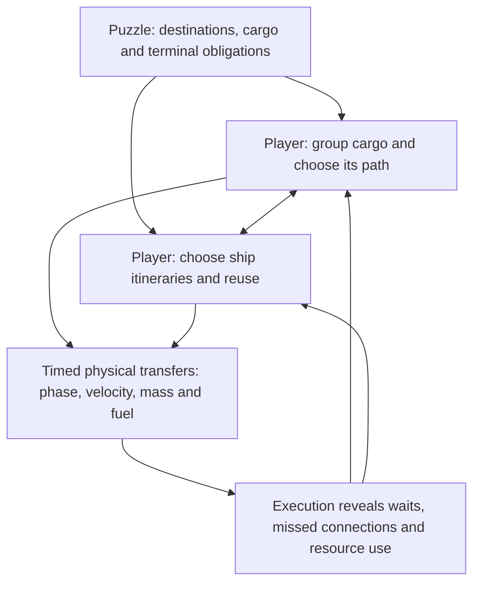
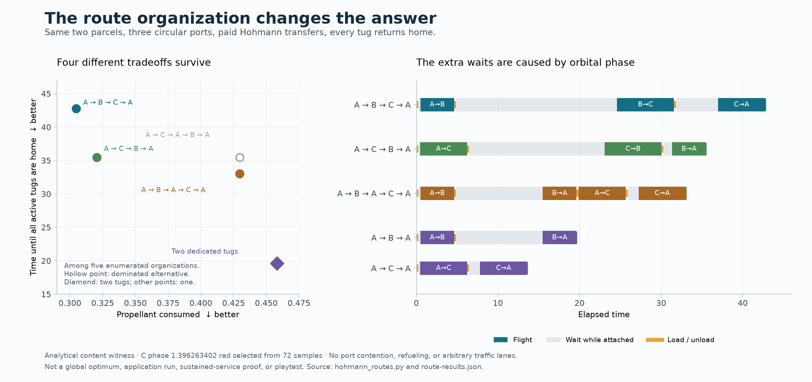

# What does the player construct? — design reconsideration, 2026-10-07

Status: research and a proposed next gameplay gate, **awaiting user design review**.
No application feature was implemented. This revisits the periodic-service plan
in response to the user's concern that its core feels unlike the construction
games it references. It includes an independently delegated `gpt-6-astra`/xhigh
game-design consultation, with freedom to research, experiment and delegate.
Astra used a Sol research/experiment subagent; this was not the constrained CLI
senior-review flow. Its [recommendation](consultant/recommendation.md) is retained
separately from this synthesis.

## Recommendation

Change the next **game-validation** gate from “program the two-port service twice”
to **“invent and improve a three-port courier service.”** Keep the timeline and
bounded transfer compiler as useful authoring tools, but build them around a
demonstrated task rather than treating repetition as the new game mechanic.

The promising direction is a finite transport-network construction puzzle with
orbital physics: fixed delivery requirements, a small hardware allowance, and
player-authored cargo grouping, itineraries and vehicle circulation. The current
editor supplies physical execution and close inspection. This is a hypothesis,
not a claim that network organization will be more enjoyable than trajectory
design. A finite mission-design game remains a credible alternative.

## There is more than one axis

The useful distinction is the **object being designed**, and how changing one
part changes the opportunities elsewhere. Transformation and spatial restriction
are powerful sources of that interaction, but neither is mandatory.

| Reference | Player-authored object | Typical coupling | Role of the program/schedule |
| --- | --- | --- | --- |
| Opus Magnum | Manipulator apparatus and a transformation procedure | Reach, rigid assemblies, occupied space, shared tools and operation order | Choreographs the invented apparatus |
| SpaceChem | Reactor procedure and connected production stages | Two local instruction streams, material structure, reactor layout and inter-stage flow | Executes local transformations and their composition |
| Infinifactory | A spatial assembly apparatus | Product shape, conveyors, welders, actuators and material flow | Behavior emerges from placement and local machinery |
| Factorio | A production/transport plant | Recipes, throughput, placement, inventories and shared infrastructure | Operates the constructed plant; interrupts remove repetitive dispatch work |
| OpenTTD | Infrastructure, services and vehicle capacity | Connectivity, transfers, demand, journey time, shared capacity and economic cost | Orders operate services; timetables improve regularity |
| Current orbital fixture | A journey on an almost fixed A↔B connection | Phase, duration, mass/fuel and return readiness | Specifies and executes the physical journey |
| Proposed courier probe | Cargo grouping, stop order and vehicle reuse | One stop changes carried mass and the next reachable departure; reuse competes with parallel service | Makes the chosen organization executable and inspectable |

Mechanics are grounded in the [consultant's primary-source notes](consultant/reference-notes.md)
and [OpenTTD source study](source-notes.md); the classification is our inference.
An open board in Opus Magnum still has local geometry and reach. Conversely,
transport can be expressive without transforming its cargo. “Add obstacles” and
“add manufacturing” are therefore premature prescriptions.

The crucial diagnostic is **reorganization**: does improving one part create a
reason to change how another part works? More independent deliveries merely
multiply a local problem. A repeat command may expose a fleet-capacity constraint
without introducing another interesting structure to invent. These are conditional
claims about a simple fixed-route fixture, not claims that all scheduling reduces
to arithmetic.

## Orbital geography is a constraint in state and time

There is little need to route around other ships' drawn lines. Crossing curves
are not a junction or a conflict. Rendezvous instead requires position **and
velocity at the same time**; changing cargo changes the fuel bill, and arriving
at a stop changes which onward opportunities remain available. These are native
constraints worth exploiting before adding traffic rules.

The middle layer is currently thin. Numerical targeting may make the bottom layer
easier without creating that middle layer. The revised proposal tests it directly.
A service diagram expresses connectivity; the orbital map explains why a
connection costs what it does; the timeline explains when reuse and connections
work. None should replace paid, simulated trajectories with decorative edges.

A time-space network is a useful analytical analogy from
[service-network research](https://www.sciencedirect.com/science/article/pii/S2192437620300327):
the same location at different times has different useful connections. This is
an explanatory model, not a plan to discretize canonical physics or build a global
route solver. With three ports, their relative periods need not share a convenient
global cycle; repeated intent must not assume the environment resets.

## What the OpenTTD investigation changes

Source inspection separates physical infrastructure, vehicle order lists and
cargo service links. Orders are not the entire game. Cargo demand, service quality
and finite capacity give those orders purpose. Trains add constructed track and
platform exclusion; aircraft remove constructed corridors but retain airport
capacity and fleet/network choices. Its optional timetable is not an Opus Magnum
instruction clock.

The [unbunching design diary](https://www.openttd.org/news/2024/02/10/unbunching)
also cautions against mistaking operational chores for depth: it deliberately
automates vehicle spacing. Likewise, Factorio's
[space-platform design](https://www.factorio.com/blog/post/fff-381) locates much of
its puzzle in the constructed onboard factory, while simplifying repetitive
logistics. These references support automating numerical aiming and routine
service consistency while preserving consequential design decisions.

Borrow the separation of service intent from individual execution, cargo/next-hop
views and bottleneck diagnostics. Do not import OpenTTD's whole economy, track
signals, or traffic into orbit. Source/document study is not an OpenTTD playtest;
the pinned development revision and exact code links are in [source notes](source-notes.md).

## A physical witness for the smaller gate

Astra's team enumerated five service organizations over 72 phases of a third
circular port. The selected phase deliberately exhibits a clear tradeoff. Two
parcels start at A: one for B, one for C. Every active tug must return home.
Both Hohmann impulses are paid, cargo remains aboard until service completes,
and waiting takes place attached to a port. No refueling or traffic restriction
was introduced.

| Organization | All active tugs home | Fuel consumed | Active tugs |
| --- | ---: | ---: | ---: |
| A → B → C → A | 42.741 | 0.304632 | 1 |
| A → C → B → A | 35.481 | 0.320471 | 1 |
| A → B → A → C → A | 33.022 | 0.429653 | 1 |
| Separate A → B → A and A → C → A | 19.627 | 0.458221 | 2 |

All four are nondominated **among the five enumerated organizations**, not globally
optimal routes. The fifth, C-first serial shuttles, is dominated. The revealing
case is that the extra return-home leg finishes sooner: continuing B→C waits for
a departure at 24.60, whereas going home first catches A→C at 19.90. The extra
travel costs fuel but saves about 9.72 overall time units.

This uses A:r1, B:r1.4 with the current phase, C:r2/phase1.396263402, two parcels
of 0.2, dry mass1, exhaust velocity3 and fuel0.6 per tug. The current app starts
with fuel0.2/cargo capacity0.2; the experiment deliberately allows carrying both
parcels and more fuel. It does not establish validity within the current targeter's
bounded domain. Six directed legs were checked by separate DOP853 integration
(maximum endpoint position error 1.34e-13). All cargo/fuel ledgers were checked,
and the root agent reran the calculation. This is an analytical content witness,
not app execution, sustained service or evidence of fun. Reproduction and full
selection provenance are in the [artifact index](consultant/README.md).

The **three one-tug alternatives** are sufficient for an initial hands-on probe;
the two-tug result illustrates a later hardware choice and does not require joint
simulation before testing the first question.

## Proposed next experiment and stop conditions

1. **Prepare one finite three-port scene.** Verify the candidate organizations in
   the canonical runner, with explicit paid burns/service and fixed starting
   rules. Add only the minimum route-order/transfer authoring needed to let the
   player make the choice. Start with one tug; keep simultaneous ships deferred.
2. **Let the player construct, run and improve a service.** First deliver both
   parcels and return, then improve a chosen time/fuel metric. Observe whether
   they voluntarily change cargo grouping or itinerary and can explain the effect
   on another leg. Merely selecting one of four precomputed answers is not this
   gate; candidate transfers are scaffolding, not the entire solution interface.
3. **Build the authoring tool the task needs.** If organization is compelling and
   timestamps obscure it, implement the small compiler/timeline around this finite
   scene. If trajectory invention is the enjoyable act, favor finite mission
   synthesis. If neither prompts useful revision, revisit the core before adding
   runtime, factories, stations or larger fleets.

These are recommended gates, not newly authorized implementation. Exact puzzle
thresholds and targeter-domain changes require preparation; the analytical
scores must not be pasted into application evidence.

Only after this gate should we test whether repeating a useful service creates
new inventory/vehicle dependencies. Then compare propulsion on the same concrete
organization problem: do faster transfers change consolidation/reuse, or erase
them? Hohmann is the experiment's convenient controlled family, not a product
commitment. A torchship regime is neither rejected nor assumed to repair depth.

## Disposition of the previous proposal

| Previous decision | Disposition | Reason |
| --- | --- | --- |
| Recipe/timeline as immediate next gameplay gate | **Defer** | It solves authoring before testing a new player-authored object. |
| Intent → bounded prefix resolution → explicit paid events | **Retain** | Useful architecture regardless of chosen puzzle core. |
| Horizontal activities and fuel/cargo/Δv traces | **Retain as tools** | They can explain dependencies; they do not establish the dependencies' value. |
| Two voyages before broader content | **Replace as product probe** | Three-port route organization is a cheaper discriminating question; reuse evidence remains valid. |
| Propulsion comparison | **Retain, move after concrete organization probe** | Measure which design choices survive, not only how quickly a leg completes. |
| Shared berth, relay, factory or depot | **Conditional** | Demonstrate a useful physical/resource role before adding one. |
| Runtime scheduler/general event language | **Continue to defer** | No demonstrated task yet requires this scope. |

The user is deciding between **designing transport organization** and **designing
physical journeys**, with a recommendation to try the small courier probe. This
does not reject the replay/choreography aesthetic, the CoaDE editor, or eventual
periodic intent. It changes what we ask the next slice to prove.
