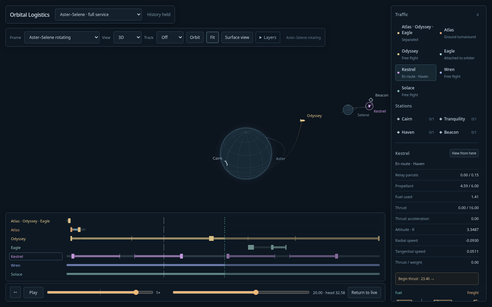
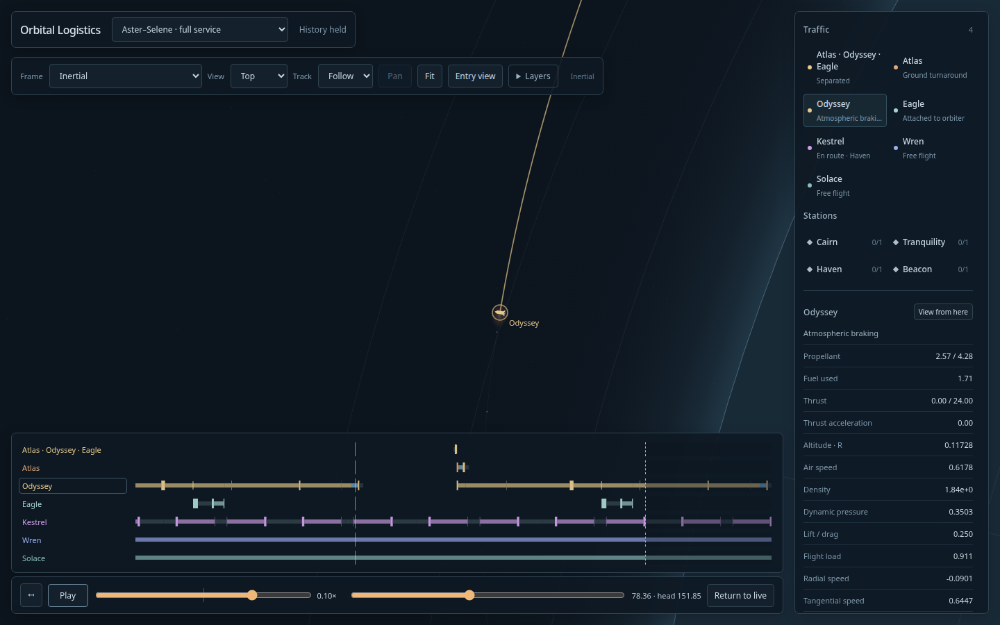

# Combined Aster–Selene service — 2026-10-11

**Aster–Selene · full service** joins Atlas/Odyssey/Eagle's staged expedition,
Kestrel's lunar surface–Beacon courier, and free satellites Wren and Solace.
Cairn, Tranquility, Haven and Beacon have separate terminal/stock ownership.
The assembly and individual stages remain selectable on seven single-line lanes.

The independent clocks share complete published epochs, rolling history and
resource anchors. Staged caches compile once and courier caches once; free satellites
use canonical eight-unit continuation. This is a prepared exhibit, not a joint
route optimizer. Beacon is the actual-field ideal outer equilibrium reference.

Validation commands:

```sh
node --import tsx --test tests/sim/aster-system.test.ts tests/sim/staged-service.test.ts tests/sim/camera.test.ts tests/sim/libration.test.ts
uv run --project spikes/numerics --group plots python spikes/numerics/aster_system_oracle.py
npm run build
PROFILE_OUTPUT=docs/design/aster-system/profile.json PLAYWRIGHT_PREVIEW=1 npx playwright test tests/browser/aster-system-profile.spec.ts tests/browser/aster-system.spec.ts tests/browser/libration.spec.ts tests/browser/staged-service.spec.ts
node --import tsx scripts/aster-system-close-profile.ts
```

Sixteen focused simulation checks pass, including 1,024 units of combined service:
fuel/parcel conservation, exact provider versus frontend states, berth occupancy,
held playback, poisoned publication failures, passive fault isolation after history
eviction, and stable marker positions/visibility across reconstruction and reassembly.
An injected aggregate overflow refuses before replacing any visible backing store.
A cold three-cycle packet measures **59,245,578 bytes**, below64 MB.
Retained physical ownership peaks at167,984 nodes/~52.50 MB; observed private
construction at172,082 nodes/~53.42 MB. A reusable template costs~15.95 MB separately.
These are serialized accounting diagnostics; JS/browser heap costs are greater.

The trial lunar satellite at radius.48 failed its clearance certificate around
631.42. Radius.35/inclination35° passed the 2,048-unit candidate rollout and the
integrated1,024-unit run without a satellite fault. Through128 units, h/2 worst
six-state difference is1.592e-10; independent DOP853 is1.730e-10 (257 samples,
rtol2e-12/atol2e-13). This is a bounded witness, not proof of indefinite stability.

Four production browser checks pass: the rendering matrix, the combined exhibit
through three staged trips at16×, and existing Beacon/staged regressions. Checks
cover reverse/Live, selection, switching, funded refills and phone/1440p/4K lanes.
The earlier eight-check responsive/reverse pass also succeeded. After offscreen
path culling, the combined browser check is repeated on the final build.

## Rendering measurements

Production headless installed Chrome on natto, CSS1440×900 or3840×2160, DPR1;
selected Odyssey, oblique view, full layers. Steady active windows are10 seconds,
including recurrence construction at16×. Frozen and bodies-only controls are3.5
seconds. These are local observations, not guarantees for every browser/device.

| Set | 1440p inertial1× | 1440p rotating16× | 4K inertial1× | 4K rotating16× |
|---|---:|---:|---:|---:|
| Existing staged service | 48.8 FPS | 35.5 FPS | 27.1 FPS | 34.6 FPS |
| Combined exhibit | 46.9 FPS | 44.7 FPS | 24.6 FPS | 29.9 FPS |

Combined frozen full-layer views measured58–60 FPS; bodies-only60 FPS.
No active-window frame gap exceeded200 ms (maximum100 ms); no browser exceptions
or simulation faults occurred. Mean combined refresh costs were7–12 ms at1440p,
versus26–29 ms before retained-row byte caching. Source/CPU inspection also found
per-vertex axes construction and repeated ordered-history Map/sort assembly;
one-draw projection and ordered merges reduce those costs. The matrix precedes the
additional close-zoom culling, which skips only segments outside the viewport plus
a stroke/miter margin. Physics, per-vertex epochs and occlusion within the viewport
are unchanged. Canvas/DOM/SVG is retained; no renderer migration is justified here.

A separate held entry playback at0.1× checks inertial Follow at1440p and Chase at4K
with an actual close zoom (scale>500), live atmosphere telemetry and continued
frame delivery. Before offscreen culling, the extreme4K Chase case measured17 FPS.
With culling it measured23.9–24.7 FPS across two runs (final23.94),
while1440p Follow measured55–59 FPS (final59.43); exact
final samples and bounded timing rows are in [close-profile.json](../design/aster-system/close-profile.json).
The final extreme4K result is borderline against the24 FPS target, rather than
a guaranteed pass at every close zoom. Remaining headroom is modest in this
headless renderer; it is
not an admission for arbitrarily larger fleets.




[Design and disposition](../design/aster-system/README.md),
[profile matrix](../design/aster-system/profile.json),
[simulation log](../design/aster-system/final-sim-checks.log),
[browser log](../design/aster-system/final-browser-checks.log),
[independent reference](../design/aster-system/solace-oracle.json).
