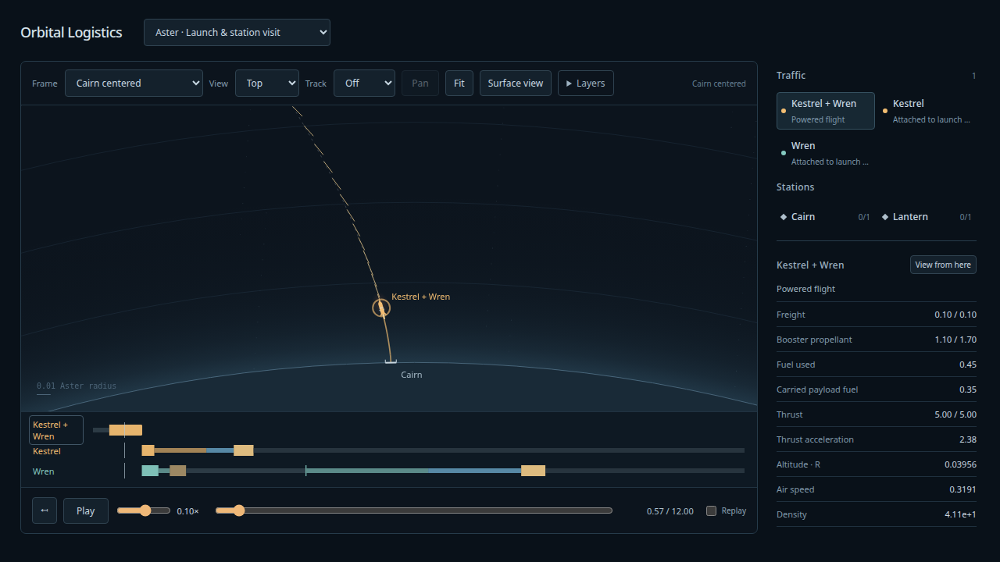
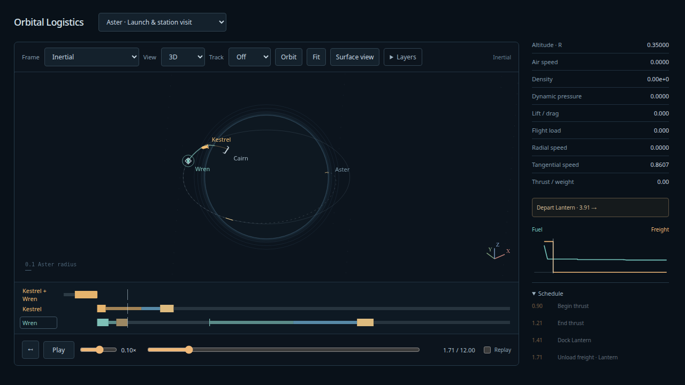
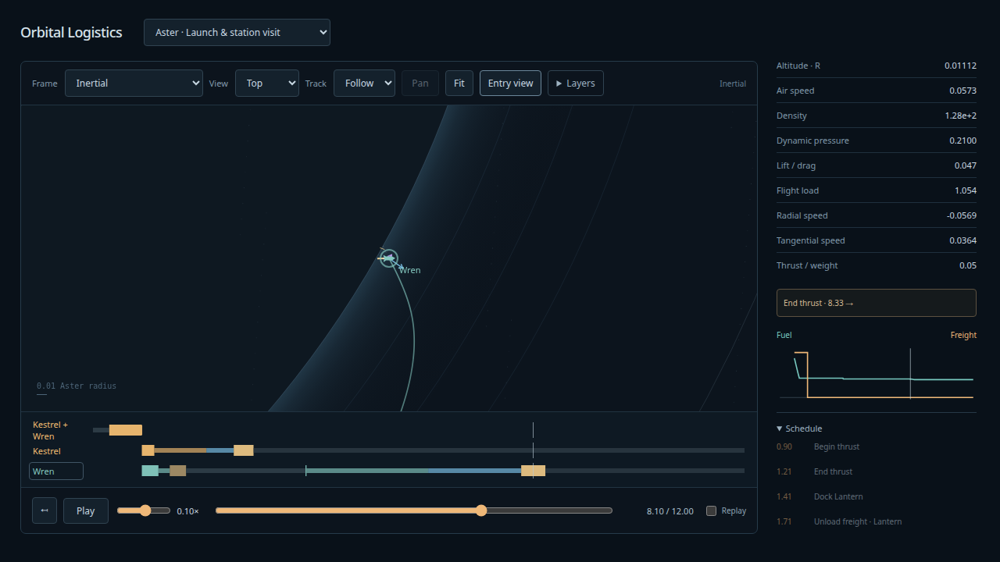

# Atmospheric launch and station visit

**Aster · Launch & station visit** is a finite 12-unit two-stage mission. It starts at 0.1×; Surface view follows the launch scale, and Entry view follows the selected returning stage. Ordinary inertial/rotating/centered frames,3D, Follow/Chase, layers, scrubbing and Replay remain available.

| Event | Mission epoch |
| --- | --- |
| Kestrel/Wren launch |0.300000 |
| Zero-kick separation; insertion and boostback start |0.900000 |
| Wren captures Lantern |1.414547073 |
| Freight unload completes |1.714547073 |
| Kestrel ocean recovery |2.957248312 |
| Wren leaves Lantern |3.914547073 |
| Wren deorbit ends |3.932717851 |
| Wren ocean recovery |8.332175956 |

The upper-stage station correction is 1.53e-9 velocity units and 8.46e-10R positional miss, with a charged 2.66e-10 fuel correction. Capture admission includes 1e-8 numerical allowance against 1e-7 physical tolerances. Both engines draw their own tanks; reserved upper fuel remains ballast before separation. One shared ledger unloads 0.1 freight once at Lantern. Final station/pad occupancy is zero; recovered ships retain their tanks and create no ocean berth.

Kestrel recovers with 0.36098346 fuel at 0.04442172 water-relative speed; Wren retains 0.15881237 at 0.03865900. Both meet the 0.06 recovery envelope. Their water impulses and removed relative kinetic energy are recorded separately in [display evidence](atmospheric-mission-display.json).

The independent original-state DOP853 branch tree reconstructs rotating pad release, its own powered ascent and split, each stage's tank, boostback/insertion, frozen station capture, post-unload mass, deorbit, drag/lift, feedback thrust/fuel and descending water contact. It never restarts from production states or rephases a station to a production endpoint. Oracle tightening difference 1.22e-11; three production grids agree on sampled states to 3.34e-10 or better. At the finest 1/2048 grid, largest sampled state-component error is1.52e-11 and largest contact-time error 2.29e-11. [Oracle results](atmospheric-mission-oracle.json).

Refined sampled ascent pressure peaks 2.23281. Highest total non-gravitational load is 3.44967 on booster entry, below the authored 4 ceiling. Observed pressure/load/heating maxima are diagnostics with margin, not continuous peak certificates. The shared half-clearance/speed enclosure bounds solid-body safety separately.

Close-view drawing samples differ from canonical physical queries by at most 0.107px at the maximum 1e6px/R zoom in the retained probe. Drawing never supplies restart states. Clone and reversed query order are identical; exact boundaries preserve capture, cargo mass change and contact event sides.

At1/2048, preparation retains 15,602 canonical nodes, checks 200,321 propagation stages (including rejected attempts/root probes), publishes 15,935 drawing samples and 7,069,841 bytes. Preparation measured 2.44sec on natto in this non-isolated run. Counters do not claim total CPU calls; drawing reconstruction and ordinary RK derivative evaluations are separate. Pad support, station dwell and recovered corotation use analytical poses.

Validation: 188 full simulation tests pass, 21 distinct production Chrome checks pass across the new mission, accepted entry/staging, viewer, camera and tracking. Final mission/entry/staging checks were repeated after the phase-aware close-view change. The new browser test checks actual playback through recovery, exact schedule jumps, rewind, both actors' outcomes, forced view changes and switching to/from continuous service. Initial new-test issues were locator/range-input automation errors; corrected tests pass. Build/typecheck and configured all-file Ruff format/lint/ty pass.

Reproduce:
```sh
uv run --project spikes/numerics python docs/design/atmospheric-launch/study.py
uv run --project spikes/numerics python docs/design/atmospheric-launch/assemble.py
npm run evidence:atmospheric-mission
npm run test:sim
npm run build
PLAYWRIGHT_PREVIEW=1 npx playwright test tests/browser/atmospheric-mission.spec.ts
```

[Architecture and review disposition](../design/atmospheric-launch/disposition.md).
The owner viewing gate is choreography. Replay repeats a prepared mission; it does not dispatch a new launch or replenish fuel.




