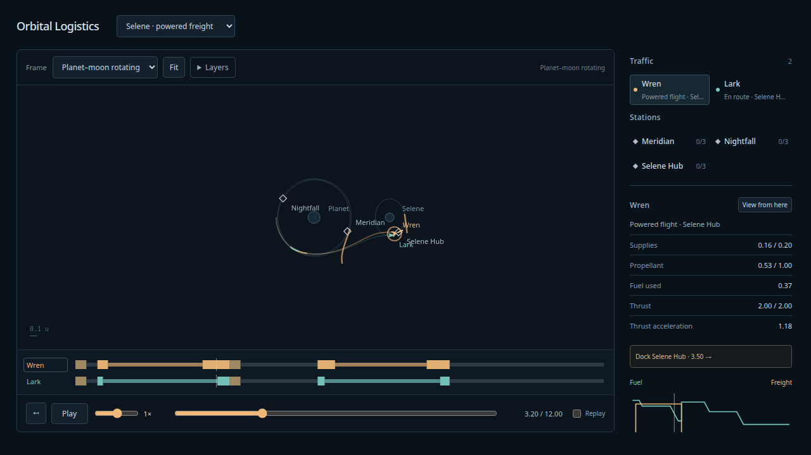

# Bounded propulsion evidence — 2026-10-08

User-authorized implementation after Astra senior review. Starting source8394ad0;
branch codex/model-set-viewer, natto. [Architecture, authoring and reproduction](../design/bounded-propulsion/README.md),
[review disposition](../design/bounded-propulsion/disposition.md).
Actual reviewed transport gpt-6-astra/xhigh, exit0; review preceded implementation.
The user already accepted stable labels and the original lunar freight set.

## Delivered

Canonical schema/modelv3 with explicit propulsion-free v1/v2 conversion; finite
constant-inertial-heading arcs, throttle, force/exhaust velocity, optional acceleration
cap; anchored mass law and canonical cap/depletion/start/end boundaries. Powered
prediction/execution/diagnostics share one propagator. Old snapshots reject with
recovery guidance. Safety includes thrust acceleration; failure retains the charged
prefix. Partial fuel/cumulative usage, exact resource jumps, powered paths/timelines,
thrust indicators and force/propulsive-acceleration readouts are visible. Logarithmic
analog speed covers approximately0.05–16×, independent of pause/physics.

| Set | Engine force | Burn durations | Final propellant | Service |
| --- | --- | --- | --- | --- |
| Orison · powered transfer / Kestrel | 1 | 0.139–0.171 | 0.543059300 | 0.16 freight to Kiln, return Anchor |
| Selene · powered freight / Wren | 2 | 0.240–0.611 | 0.237163389 | 0.16 supplies to Selene Hub, return Nightfall |
| Selene · powered freight / Lark | 4 | 0.126–0.276 | 0.344387350 | same times/delivery/return as Wren |

All units are fictional normalized quantities. Total lunar delivery0.32, finite hub
fuel stock4. No authored impulses. Small measured capture residuals are separately
charged and recorded. The original impulsive scenes are unchanged source fixtures.
The Ibis lower-force family did not yield a validated return; that route was not
silently rescued or shown as powered. All24 force/leg search outcomes are retained.

## Independent numerics and full-trip admission

`npm run evidence:propulsion` saves production output in
[propulsion-oracle-input.json](propulsion-oracle-input.json) and independently replays
it with seven-state SciPy DOP853 in `spikes/numerics/propulsion_oracle.py`. The oracle
integrates fuel as an ODE, rather than importing the production analytic mass law.
It independently integrates ballistic station targets, service/refueling, cargo,
paid captures and operation ordering. Regular rtol2e-13 versus tight2.3e-14,
atol2e-15; dense state/resource queries include exact events. No production targeting
or drawing interpolation is used as the reference.

The same authored programs run at three RK4 resolutions without retargeting:
Kestrel1/512,1/1024,1/2048; lunar1/1024,1/2048,1/4096. All complete their delivery and
return objectives. Full trips also pass the production surface-exclusion certificate
with body radii enlarged0.03; no singularity traversal/softening is introduced.

| Finest run | Max position error | Max velocity error | Max fuel error | Max oracle refinement |
| --- | --- | --- | --- | --- |
| Kestrel | 2.50e-13 | 3.12e-13 | 5.08e-14 | 1.78e-12 |
| Wren | 7.54e-13 | 2.14e-12 | 1.37e-12 | 3.95e-12 |
| Lark | 7.80e-13 | 2.14e-12 | 1.55e-12 | 3.67e-12 |

Declared sampled state budgets coarse/mid/fine1e-6/1e-7/1e-8; fuel/usage1e-8;
oracle refinement1e-9. Refinement reduces truncation error toward oracle/roundoff
floors. Capture checks use the **pre-attachment state**, separately for position and
velocity. Worst production residuals across admitted ships: position7.39e-10,
velocity1.06e-9. Each residual plus the1e-8 finest numerical allowance is below1e-7,
100× inside the1e-5 capture tolerance. Station attachment therefore cannot hide a
substantial missing braking maneuver. Resource usage, capture residuals, stocks,
full event trace and completion agree with the independent replay.

Inclined powered calibrations additionally cover acceleration-cap transition and
fuel depletion under gravity at three resolutions. Max cap state difference9.23e-14,
fuel4.09e-14, regular/tight reference difference2.09e-12. Depletion occurs at
0.423 to within1e-12, max sampled state difference8.59e-14. See the complete
[propulsion oracle report](propulsion-oracle-report.json).

## Runtime and browser validation

- 95 simulation tests pass, including the original83. Powered cases cover pure
  zero-gravity analytic rocket position/velocity/fuel, inclined directions, zero
  throttle, cap transition, off-grid endpoints, adjacent headings, query partition
  and reversal, snapshots, pre-impulse boundaries, partial cumulative usage,
  exact-end/early depletion and simultaneous next-arc start, unsafe surface approach,
  work/subdivision exhaustion, paid failure prefixes, attached thrust/overlapping
  impulses, legacy field/snapshot rejection, rotation covariance and both shared-stock
  lunar round trips. Display fuel consumption and discrete refueling are checked.
- Nine production Chrome browser tests pass. Original scenes/frames/layers/chooser,
  rewind/replay, stable labels and narrow layout remain covered. New checks exercise
  intermediate speed/pause invariance, both powered sets, burning telemetry/fuel,
  frame invariance, final stocks/returns, and zero browser/console errors.
- TypeScript/build and configured Ruff format/lint/ty hooks pass. The authoring search
  rerun produced identical per-attempt output to the preserved pre-engine run.
- Production preview4178 serves the latest build, HTTP200. Temporary Playwright4179
  closes after tests. The retained in-app tab is paused at t3.2 in Selene · powered
  freight, rotating frame, Wren selected, speed0.67×.

The screenshot and automated checks support readability/behavior, not human taste
acceptance. Next gate is watching finite burns at the desired speed. Full3D camera,
airless launch/landing, continuous service/rolling history, runtime replanning,
attitude/variable steering, actual engine calibration and a general optimizer remain
outside this slice. Replay still rewinds a finite prepared scene and its inventories.
