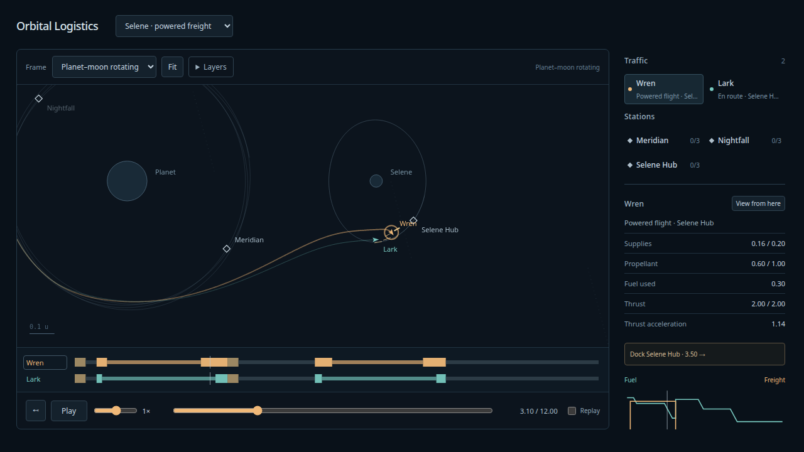

# Future thrust whiskers — 2026-10-08

User accepted finite propulsion and analog speed, requested CoaDE-style sampled
thrust vectors and a clearer distinction between future burns and flown trails.

Future selected burns now show warm direction whiskers along the dashed forecast
up to the next arrival. Samples are anchored to each complete arc and disappear
as flown. Density follows projected path length, bounded2–40 per arc. Directions
rotate at each sample's epoch, without the velocity-only rotating-frame term.
Past burns use ordinary ship-color fading trails, without the previous same-strength
highlight overlay. Plan/trail layers remain independent; no physics changes.

TypeScript/build, all95 simulation tests and10 production Chrome viewer tests pass.
The final whisker case was rerun with a zoomed screenshot. Browser checks require
future epochs only, frame support, no whiskers with plan off/trails on, no whiskers
after all burns, and zero browser/console errors. Human visual preference remains
separate from those checks.

