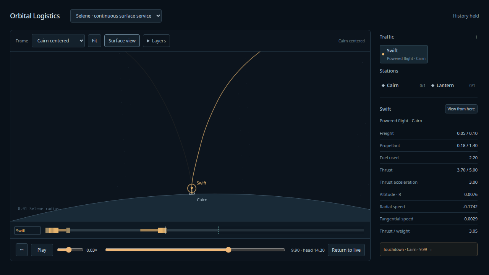
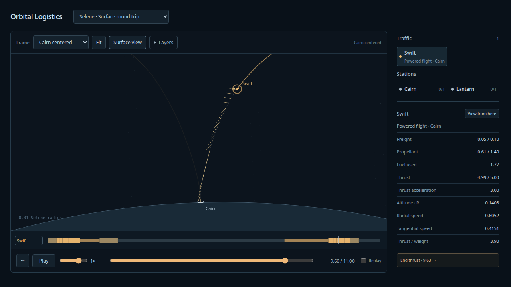

# Continuous surface service — 2026-10-08

The user accepted finite landing. **Selene · continuous surface service** repeats
Swift's Cairn ↔ Lantern flights with finite shared inventories and explicit cargo/
fuel flows. The original ascent and finite return scenes remain available.
[Reviewed contract/disposition](../design/surface-service/README.md) records the
verified Astra design review and the owner’s implementation decisions.

## Commands and checks

```sh
npm run test:sim
npm run build
PLAYWRIGHT_PREVIEW=1 npm run test:browser
npm run evidence:surface-traffic
uv run --project spikes/numerics --group dev --group plots pre-commit run --config spikes/numerics/.pre-commit-config.yaml --all-files
```

123 simulation tests pass, including eight surface-service cases: explicit domain,
private support prelude, last admissible windows, designated arrival/event ordering,
berths, stock/fuel conservation, partition/query invariance, planning/stock retries,
divergent paid execution history, missing arrival and rolling/pending retention.
TypeScript/production build, configured Ruff format/lint and ty hooks pass.

18 installed-Chrome production browser tests pass. New coverage exercises continuous
surface descent/landing, held playback, history eviction beyond 150 units, retained
rewind, frame invariance, Live, selected-set Restart and fixed/continuous switching.
The other new case independently checks exhaust-side whisker direction and actual
force/length taper in inertial and rotating frames. Whiskers remain future-only,
selected-route/layer controlled. Length is 3+15sqrt(F/Fmax) pixels; zero force is hidden.

The first browser attempt caught the sliding history minimum becoming misaligned
with the HTML range's 0.001 step. Millisecond-aligned bounds fix exact slider input;
physical seeks still clamp against the actual retained watermark. Final full suite
passed with no browser errors. The in-app preview was refreshed and inspected in
Cairn close view at 9.9, paused at 0.03125×; no captured warning/error logs.

## Independent physical and close-view admission

[Input](surface-traffic-oracle-input.json), [DOP853 report](surface-traffic-oracle-report.json).
Both unchanged legs are independently replayed at synodic indices 1, 64 and their last
admissible windows below the 1m calendar: outbound 113404 (departure 999995.519614113),
return 113403 (departure 999994.2314908255). Each uses h=1/512,1/1024,1/2048,
original local events/controls, exact capped mass law, and unmodified interval guards.
The independent oracle uses seven-state DOP853 and its own launch/support/landing,
resources and event logic. Each refined scenario's padded terminal epoch is matched;
comparing a refined terminal against an earlier frozen oracle horizon is invalid.

Across all 18 step/case combinations, maximum position/velocity agreement errors are
1.60e-12/2.84e-12; fuel/usage error1.40e-12; ordinary-versus-tight oracle refinement
2.13e-11. Pre-snap position/speed residuals, including the latest windows, plus1e-8
remain below1e-7 and the represented landing geometry bound. Every ledger event,
terminal, cargo, paid landing event sides and fuel agree. Production interval
certificates remain valid; their clearance lower bounds exceed state disagreement
by more than 1000×. DOP853 agreement is not itself an interval safety proof.

Dense drawing checks query the real main-thread view store at quarter/mid/three-quarter
points of every segment, including event-left states, across six reference frames.
Maximum interpolated-position/path error at 1m pixels per radius is 0.107792px for
ascent and 0.098308px for return; screen-path compaction adds at most 0.1px. Full dense
coverage remains queryable after history eviction; only the recent trail expands
into each render list. These are numerical display checks, not subjective feel.

## Soak, resources and storage

[1,024-unit soak](surface-traffic-soak.json),
[independent scalar resource replay](surface-traffic-resource-report.json).
Swift completes 117 flights and delivers 2.9 return freight. It eventually waits for
finite depot resources and retries a later window; no fault/unavailable stage.
Maximum cargo/fuel conservation errors5.45e-15/2.45e-13. Independent replay of all 117
completed services and clipped external flows agrees in stocks exactly and flow
totals to1.43e-14. Successful arrival/fault commits paid episode usage once.

| Measured maximum | Count or size |
|---|---:|
| Retained history | 128 units |
| Fleet frames (worker and main) |2,214 |
| Dense episode records |16 |
| Dense samples (worker and main) |58,784 of 65,536 |
| Active Runner nodes |2,234 |
| Render list (recent past plus forecast) |14,161 |
| Four-unit evidence delta, UTF-8 JSON |3,588,703 bytes |
| Serialized main cache |29,744,090 bytes |
| One held pending-reply cache |54,356 dense samples |

Actual worker requests remain at most one unit, one outstanding reply. Each episode
is capped at 16,384 samples including exact epochs; cache guard 65,536; held main
cache may temporarily include one additional episode. Four-unit evidence deltas are
more conservative than UI request size. JSON counts include episode metadata and
resource/event history; they are not JS heap sizes. No dense frame-rate fleet grid.

The preliminary 256-unit probe found full-history view rebuilding expensive (~142ms
maximum). Queryable dense coverage, recent render lists, alpha-batched trail strokes,
subpixel path compaction and bounded fuel-chart points reduced the same probe to
~11ms maximum. The longer soak measured 112.2ms maximum view construction under
concurrent checks; timing is diagnostic, not a cross-machine performance guarantee.

[Browser measurement](surface-traffic-browser.json): production headless Chrome at
frontier 160.78 with 16 retained records, Cairn close view and historical scrub gives
median/p95 frame intervals 16.7/16.8ms. Main-window used heap 56.52MB, sampled peak
100.31MB during live traffic/packet delivery. Heap is sampled every 250ms and excludes
worker heap; shorter transient peaks may be missed. Worker live Runner count, dense
cache and wire-copy bounds are measured separately above. This does not claim a
measured process-wide peak. Preview/browser observations are local natto evidence.

## Presentation and limits





One analytical fixed-primary airless pad/depot, fixed witnessed loadouts and windows;
finite global resources, memory-only rolling history and tested1m calendar. No new
steering solver, demand dispatch, persistence, atmosphere, detailed contact, stages,
stationkeeping or 3D presentation. Failed flight markers preserve last-known validity;
they do not invent a future physical orbit. Production drawing reuses prediction only
because execution is the same immutable Runner. A divergent fault adapter proves
actual history comes from its changed execution prefix while an earlier historical
cursor retains the original forecast. User acceptance of the new service/whisker
appearance remains the normal next hands-on gate.
