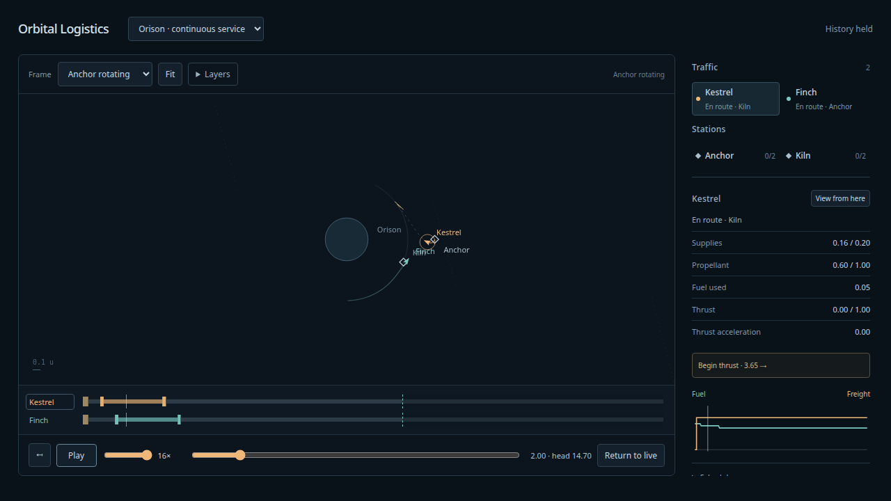

# Continuous analytical traffic — 2026-10-08

Implemented after the user's acceptance of finite propulsion and requested Astra
architecture/storage/playback review. [Review and contract](../design/continuous-traffic/README.md)
retain actual transport, verified brief, report and disposition. The review predates
implementation and is not a final-diff review.

## Watch and explore

Select **Orison · continuous service** at http://127.0.0.1:4178/.
Two ships repeatedly serve Anchor/Kiln with finite powered transfers, actual loading,
unloading and refuelling, finite station buffers, explicit cargo/fuel imports and
cargo exports. No scene rewind replenishes resources during Live operation.
Future thrust is shown as sampled vector whiskers; flown trails fade separately.

Pause holds the viewed epoch and stops new advances; one pending bounded reply may
finish at the held head. Scrub within the retained128 time units. Play replays past
history and resumes live when caught up. Return to live jumps to the acknowledged
head. Restart run creates a fresh seeded session. A dashed head line separates
committed history from known future plans on each timeline. Future event jumps are
disabled until flown. Hiding the tab pauses without accumulating wall-clock debt.



## Validation

- Build/typecheck,103 simulation tests and12 production Chrome checks pass. Suites include previous finite
  sets plus continuous history, pause/play/live/restart, stale worker cancellation,
  delayed pending replies, and hidden-tab behavior. Tests retain no browser server.
- Fleet partition/query independence compares exact authoritative snapshots across
  different advance partitions and work budgets. Display queries do not advance or
  restart physics. Exact event sides and original local capture epochs are retained.
- Resource tests cover full/empty buffer flows, stock shortages with retry, serviced
  loadouts retained across failed planning, and a failed production admission that
  advances windows without repeated service charges.
- A trusted test-only adapter supplies a real canonical Runner with a failed paid
  flight. Its consumed fuel remains charged, last-known epoch is retained, its frame
  origin becomes unavailable, and the other ship continues. Unsafe production
  episodes remain rejected before departure. Shared runtime/worker errors pause all.
- [Soak](traffic-soak.json):2,048 time units,384 service completions, both ships over
  180 voyages,30.56 cargo delivered. Worker and main histories peak at2,169 fleet
  frames,26 episode records; worker peaks at122 event boundaries,198 events,26 stock
  anchors and12,398 active canonical Runner nodes. No retained array grows with total
  session duration. Cumulative counters intentionally grow; tested calendar ceiling1m.
- Soak conservation maximum cargo error2.71e-14 and fuel error1.21e-13. A separate
  Python scalar replay of all384 atomic transfers and signed clamped flows matches
  station stocks to4.45e-16 and actual import/export totals to7.11e-15;
  [resource report](traffic-resource-report.json).
- [Independent DOP853](traffic-oracle-report.json): both directions at window indices
  1,64,10000;6 flights x3 production steps. Same-program h/h2/h4 state/fuel/usage,
  original event traces, pre-snap capture residuals and oracle refinement pass. The
  finest state allowance is1e-8; position and velocity residual plus allowance each
  stay below1e-7. Production whole-trip radius enlargement0.03 passes all18 runs.
  Inputs retain generated local programs and original samples in
  [oracle input](traffic-oracle-input.json). Legacy puzzle completion is deliberately
  not the criterion for successful runtime capture.

Reproduce:

```sh
npm run build
npm run test:sim
PLAYWRIGHT_PREVIEW=1 npm run test:browser
npm run evidence:traffic
uv run --project spikes/numerics --group dev --group plots pre-commit run --config spikes/numerics/.pre-commit-config.yaml --all-files
```

This is a memory-only fixed-route runtime on analytical two-station rails, with
revalidated rotated finite-flight templates. It is not a general shooting optimizer,
a closed economy, lunar continuation, maintained station, rescue dispatcher, save/resume
system or3D viewer. Future extensions can replace the dispatcher while preserving
flight admission, atomic fleet commits and history validity.
