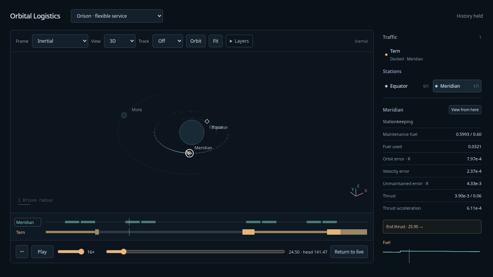

# Flexible maintained service — 2026-10-09

Implemented as **Orison · flexible service**, after the user accepted flexible
schedules and relay dwell. [Reviewed contract and reproduction](../design/flexible-service/README.md)
contains the Astra transport, decisions, frozen inputs and raw results. The previous
maintained/analytical/surface sets are preserved.

Tern's departure, flight duration, passive relay dwell and return are selected
jointly. Meridian carries the docked ship's dry/cargo/fuel mass using its own
engine/tank. Tern explicitly delivers fuel to Meridian, then returns on its reduced
fuel. Capture is bounded and paid through the same helper used by ordinary Runner
operations. Complete coupled plans are admitted atomically; failed windows retry.
The optional details retain provenance rather than adding more captions.

## Physical and ownership checks

The finite witness departs5, arrives20, transfers at20.5, releases39.5 and arrives
home52.5. Visitor burn fuel.1871742170, burn/capture delta-v.3051730728,
station burned fuel.0440774506, delivered fuel.0314051966, final visitor fuel.6814205864.
Its sampled radius stays2.000229–3.045570. Two loaded controller checks occur;
one applies a paid correction and the other skips inside the deadband. Later
original-anchor stream replay includes consecutive loaded corrections at104/112.
Transfer changes no aggregate mass or state; visitor thrust is absent while docked.

Independent22-state DOP853 integration starts from original station/origin/visitor
states, not JavaScript target providers. The additional two states integrate burned
fuel separately from inventory transfers. Finite visitor position/velocity
agreement≤4.33e-12/1.52e-12; station position≤1.72e-13; fuel≤1.06e-12.
Frozen controls at h1/128,1/256,1/512 retain paid captures; visitor position
change≤4.99e-11, approaching the numerical floor. No retargeting occurs: finer
runs derive their own anchors from the same controls and original states.

Force-sphere tests cover rotated axis forces outside the old cube and feasible
finite differences at the sphere edge. Antipodal tangent seeds remain finite
on both sides of180°. A separate aggregate station primitive with a smaller
*test-only* acceleration cap verifies force-to-cap transition and engine-tank
depletion. The exhibit's attached hardware cannot reach its acceleration cap,
so its actual parameters were not changed to manufacture that transition.

Adversarial checks reject wrong identity/hardware/initial fuel, unfunded delivery,
changed loaded controls, unsupported event times and incomplete streams. Source
mutation cannot change a reconstructed plan. Failed capture/transfer/release tests
stop at the actual event-left station/visitor fuel and mass; no ghost top-up or
future movement is drawn. Different request sizes and solver yields preserve
admitted JSON/events/physical states, and scrubbing cannot rebase physics.

## Sustained service

Sequential512 then1536 simulated-unit runs are retained. The final512 work-instrumented
rerun preserves the earlier schedule and physical outcome.

| Witness | Completed returns | Admitted pairs | Retry windows | Controller failures | Station fuel at head | Fuel delivered |
|---|---:|---:|---:|---:|---:|---:|
|512|6|7|6|0|.5893463|.3590798|
|1536|19|20|21|0|.5686437|1.0985168|

The longer run's departure gaps are72–87 units, median80; relay dwell16.5–26.5,
median19.5. Visitor burn fuel per admitted pair is.183010–.267270. The first
admitted pair burns.212747, versus.444396 for the previous fixed-clock first pair;
the lower-cost finite witness above is an additional candidate, not the exact online
first choice. The declared routine corridor/burn limits exclude close, expensive
returns. These are bounded-family results, not globally optimized schedules.

Original-anchor independent DOP853 replay follows all20 sealed plans and the full
station-control stream through1544, including the last four units beyond the actual
1536 head. All40 paid captures satisfy residual+1e-8<1e-7. Early departure6 and
late1494.5 visitors agree within6.39e-10 position,1.30e-10 velocity and1.26e-10 fuel;
station position≤8.93e-12. All20 serialized base anchors agree within1.39e-10.
A looser independent replay differs by≤1.65e-8 over this long horizon. Independent
refills use finite stock/clipped imports and conserve fuel. Final actual runtime
fuel conservation error1.78e-15. Visitor episode-end comparisons use the event-left
state before the separate origin-refuel jump; actual fleet frames own that jump.

Final512 measured max opportunity work1,423 evaluations, four complete attempts,
against explicit visitor768/controller4,224 shared caps. Final physical promotion
composed count118,110 and longer-run123,745 are below180,000; they are conservative
composed retained-node counts, not all temporary heap. Candidate proof has its own
220,000-node check. Retention budgets enforce65,000 actual-world nodes,28 drawing
chunks, six visits and8MB per reply/view; heads retain2,056 frames, two visits and
18/19 chunks. Full head packets are4.46/4.59MB. The high-warp browser profile's view
is4.465MB, observed main-thread heap peak50.14MB, one98ms Long Task from the whole
load/run witness. Worker heap and unobserved transient peaks are excluded.

## Browser and regression evidence

153 simulation checks pass in the final full run; the later pure capture-input
validation plus exhausted-controller coverage add two checks (155 distinct) and focused logistics/landing/capture
coverage passes.28 production Chrome tests, build and configured Ruff-format/lint/ty
hooks pass. Final flexible/legacy maintained browser repetitions and an opt-in
high-warp profile also pass. Tests cover fuel delivery, aggregate loaded thrust,
quiet station markers, exact pause acknowledgement, history/frame invariance,
Live/restart and fixed/continuous worker switches. The shared profile accepts set/
frontier parameters rather than maintaining a duplicate profiler.

Browser validation found a short-forecast race: after an idle planning boundary,
the new head could exceed the old view end while100ms drawing batching still held
the previous scene. Immediate refresh when crossing that end fixes the reproduced
animation-loop exception. Bounded planning remains in the worker; it can hold logical
time while solving, especially at high warp, without implying a perfectly steady
wall-clock playback rate.

Human cadence/choreography acceptance is pending. The runtime remains one coplanar
courier, one maintained station and a prescribed perturber, with a bounded economical
transfer family. Phase locking, arbitrary online spatial targets, multi-visitor
routing/rescue and new in-flight disturbance models are separate extensions.
