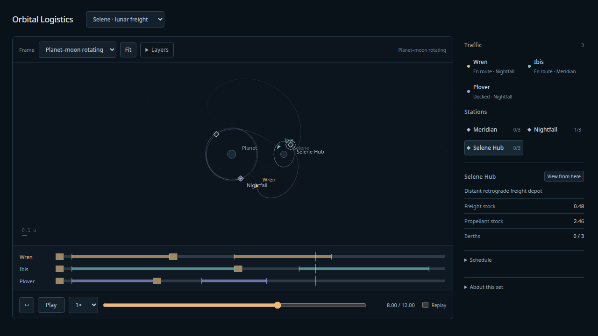

# Lunar freight evidence — 2026-10-08

Implemented after the [Astra-reviewed spatial foundation](spatial-foundation.md).
The new **Selene · lunar freight** set is available in the main viewer at
`http://127.0.0.1:4178/`. The fictional binary, DRO and normalized units inherit the
accepted lunar-loop fixture. [Search design and target semantics](../design/lunar-freight/README.md)
explain the bounded authoring and finite ballistic port model.

## Prepared voyages

All vessels start with dry mass 1, propellant 0.9, exhaust velocity 3 and load 0.16
supplies during a 0.25-unit service. Each unloads at Selene Hub, refuels to 0.85 from
finite hub inventory and returns empty. Four explicit impulses per voyage and any
capture residual are charged using the actual mass at that event.

| Vessel | Home | Hub arrival | Return departure | Home arrival | Final propellant |
| --- | --- | ---: | ---: | ---: | ---: |
| Wren | Nightfall | 3.5 | 5.5 | 8.5 | 0.42967010 |
| Ibis | Meridian | 5.5 | 7.5 | 11.5 | 0.08607003 |
| Plover | Nightfall | 3.0 | 4.5 | 6.5 | 0.39736126 |

Together they deliver **0.48 supplies** and return with more than 0.05 propellant.
Combined finite-stock and berth admission passes. The prepared runs have no joint
handoff, runtime dispatch or ship-to-ship dynamics. The 12-unit scene rewinds its
inventories on Replay; it does not establish physical recurrence or sustained service.

## Gates and independent comparison

1. Seven of sixteen bounded outbound seeds pass delta-v/fuel/clearance/tightening
   gates. All seven pass canonical RK4 steps 1/1024, 1/2048 and 1/4096 through t=12,
   matching both position and velocity within 1e-8 at arrival and co-location within
   1e-7 after another 0.75 units. Enlarged-surface canonical runs certify 0.03 surface
   clearance for both visitor and target throughout the interval.
2. Forty-eight bounded return seeds produce three complete trips. The independently
   integrated initial depots and DRO are finite burn-free targets, not prescribed
   circular rails or uncharged stationkeeping. The final set validates every target's
   entire validity interval before admitting a ship.
3. The full logistics oracle independently replays all ships, moving sources,
   ballistic target states, burns, capture, service, fuel and station resources using
   SciPy DOP853. It compares event classes and physical states **before attachment**,
   so snapping cannot hide arrival error. All three RK4 policies pass their declared
   state budgets: 1e-6, 1e-7 and 1e-8 respectively. Full-trip enlarged-surface canonical
   runs also certify 0.03 clearance for every ship, including docked intervals.

The highest-error voyage is Ibis: sampled velocity errors decrease from 2.773e-7 to
1.015e-8 to **3.737e-10** with those three steps; finest position error is **4.037e-11**.
The set therefore uses **1/4096**, rather than accepting the 1/2048 run against the
final 1e-8 state budget. Tightening the independent oracle changes state by at most
4.067e-11. Finest pre-attachment position/speed comparison errors are at most
3.749e-11 / 1.424e-10. All captures retain positive margin inside 1e-5 tolerances,
including twice the declared numerical state budget. Finest fuel disagreement is
at most 5.167e-11. Wren/Plover sampled state errors are at most 2.135e-12.

Raw artifacts:

- [Canonical free-flight checks](lunar-rendezvous-canonical-report.json),
  [independent input](lunar-rendezvous-oracle-input.json),
  [independent report](lunar-rendezvous-oracle-report.json).
- [Full logistics input](lunar-freight-oracle-input.json),
  [full logistics report](lunar-freight-oracle-report.json).
- [Set/program JSON](../../fixtures/model-sets/selene-freight.json),
  [search input and all seed outcomes](../design/lunar-freight/README.md).

## Reproduction and checks

```sh
npx tsx scripts/lunar-experiment-input.ts
uv run --project spikes/numerics python spikes/numerics/lunar_freight.py
npx tsx scripts/lunar-rendezvous-evidence.ts
uv run --project spikes/numerics python spikes/numerics/spatial_oracle.py --milestone lunar-rendezvous
uv run --project spikes/numerics python spikes/numerics/lunar_return.py
npx tsx scripts/lunar-set-fixture.ts
npm run evidence:lunar
npm run test:sim
npm run build
PLAYWRIGHT_PREVIEW=1 npm run test:browser
uv run --project spikes/numerics --group dev --group plots pre-commit run --config spikes/numerics/.pre-commit-config.yaml --all-files
```

83 simulation tests pass, including resources, target validity/safety, docked query
independence, undock continuity, inclined ballistic capture/replay and full 3D residual
rejection. Seven production Chrome tests pass; the lunar case was rerun after the
final 1/4096 policy and provider bounds. It checks the three voyages, resource
inspection, scrubbing, rewind and view-frame invariance. TypeScript build and Python
Ruff format/lint/ty checks pass. Both bounded searches reproduce their retained JSON
exactly after final script refactoring. Spatial foundation oracles remain regression gates.



Screenshot inspected at t=8 with Selene Hub selected: 0.48 freight delivered,
Wren/Ibis returning and Plover home. Label anchors remain stable, with overlap fading.
User acceptance of this new content and label behavior remains a hands-on judgment.
Synchronized analytical views were optional and deferred; the viewer still projects XY.
