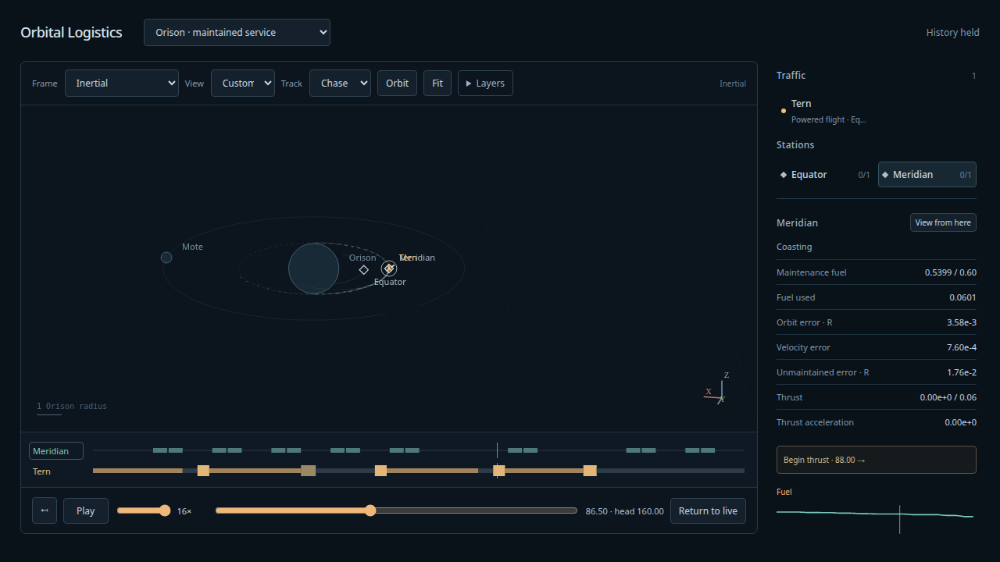

# Continuous maintained service — 2026-10-08

The user accepted finite maintenance and Follow/Chase, then requested online
stationkeeping/targeting and quieter station corrections. The
[Astra-reviewed architecture and disposition](../design/maintained-service/README.md)
now has a separate `maintained-relay-v1` runtime. **Orison · maintained service**
computes paid station corrections and each admitted visit/return as time advances.
The previous finite and analytical/surface sets remain available.

## Runtime witness

`npm run evidence:maintained-service` retains the
[raw input and frozen control stream](maintained-service-input.json),
[runtime report](maintained-service-runtime.json) and
[independent oracle report](maintained-service-oracle.json).
At simulation head512, nine pairs have completed and a tenth is in flight. Departure
windows are30,70,110,150,190,230,382,422,462,502;17 unsuccessful planning windows retry.
The longest gap reflects the bounded fixed transfer family and dispatch envelope,
not a hidden alternative route. Station forecasting has69 checks,54 corrections,
15 skips and zero solver failures through552. Current station fuel is .2810146515,
with .3189853485 paid; no tank reset. Tern's cumulative paid fuel is4.1218362463,
including its current flight. Origin imports3.7922348749 into a finite buffer;
ship/stock/import conservation error is−1.776e-15.

Observed actual station geometry error over512 units is≤.009336916 distance and
≤.008353641 speed. The .02/.005 dispatch envelope is checked at scheduling epochs;
it is not a continuous velocity-error guarantee during corrective burns. Solvers
maintain phase-free geometry and may temporarily exceed that dispatch threshold.
Failed dispatch waits; already admitted safe flights continue.

Production h=1/256, forty-unit append-only lookahead and128-unit disposable history
stay within the declared limits. Peak report values:

| Measurement | Observed peak |
|---|---:|
| Owner physical chunks | 6 |
| Conservative aggregate retained-node estimate | 61,675 |
| Display chunks / visits / frames | 22 / 5 / 2,063 |
| Incremental packet UTF-8 bytes | 615,058 |
| Conservative retained display component bytes | 6,147,705 |
| Accepted pair solver evaluations | 102 of192 |
| Single24-work-step pump duration, Node on natto | 526.55ms |

The standalone soak took26.7s. Timing is one host sample and excludes browser painting,
worker cloning and garbage-collection peaks. Serialized bytes are not heap/RSS.
Full snapshot packets are independently checked against8MB. The simulation test also
serializes all retained display components to verify the cached byte bound covers them.
The calendar guard is10000; this evidence validates512 actual units and the admitted
late pair through534, not arbitrarily long operation or maintenance fuel replenishment.

## Independent physics and convergence

The Python DOP853 oracle integrates the complete frozen station force stream from
its original state/fuel, independently of RK4 chunks. It compares all retained check/
control-end/anchor states through512. Maximum position/speed/fuel disagreements are
5.373e-12 /1.020e-12 /2.332e-15. Ordinary versus tightened oracle disagreement is
6.348e-11 in seven-state norm. Each early/late leased provider also agrees with this
full stream within3.281e-12, covering accumulated anchors rather than only local replay.

The first pair at30 and the late pair at502 replay the same frozen finite forces at
h=1/128,1/256,1/512 without retargeting. At production h:

| Pair departure | Visitor position | Visitor speed | Station position | Final visitor fuel |
|---|---:|---:|---:|---:|
| 30 | 2.378e-11 | 4.994e-12 | 5.851e-13 | .4556035622 |
| 502 | 8.173e-12 | 1.528e-12 | 1.545e-13 | .4661401517 |

First position refinements are16.65× and16.92×; finer results approach the oracle floor.
Independent pre-capture position residuals are≤2.317e-11 and speed≤2.675e-12,
comfortably below1e-7 after the1e-8 numerical allowance. Every residual velocity match
is paid using the rocket equation. Event traces, fixed carried cargo, force/acceleration
caps, maintenance fuel and capture costs are checked. No authored impulses execute.

## Regression and viewer checks

- Production build and145 simulation tests pass. New tests cover partition/work-budget
  invariance, repeated paid visits, owner/provider identity at joins, cumulative fuel,
  historical display/held replies, bounded retry/coast, attached shared halt, isolated
  depletion and unsupported-domain rejection. Circular quarter/three-quarter coast
  checks calibrate the Lambert seed independently of the shooting implementation.
- The new production Chrome service check passes through three completed returns,
  history eviction, quiet station lane, paused head/cursor, frame/Follow/Chase invariance,
  Live, restart and mixed fixed/continuous generation changes.
- All27 production Chrome tests and configured Ruff format/lint/ty hooks pass.
  The final fault-history refinement is followed by all five maintained simulation
  checks and repeated live browser checks. A final repeat exposed a non-grid paused
  cursor losing its exact head when a pending reply arrived; keeping one held pose
  plus a committed right bracket fixes it, with deterministic regression coverage.
  Historical screenshot/performance artifacts
  regenerated by the suite are restored rather than changing earlier evidence.

Astra reviewed the architecture, not the final code. Physical lookahead failures pause
at the last acknowledged head; they are not early actual collision events. Free-flight
faults preserve their paid prefix, while attached failures halt before unsupported
maintenance. The current fixture has one visitor, fixed ballast and no relay exchange;
maintenance with docked mass/refueling, multiple visitors, adaptive timing, noncoplanar
online targeting and demand scheduling remain separate extensions.

## Scheduling/performance follow-up

The user subsequently reported long waits and playback hitches. The
[2026-10-09 follow-up](maintained-service-follow-up.md) extends the observed rollout
to1536, separates rigid transfer-family failures from later station fuel limits,
and records shipped display-performance fixes. It leaves live physical planning
unchanged and proposes flexible timing/dwell plus attached-mass ownership next.
