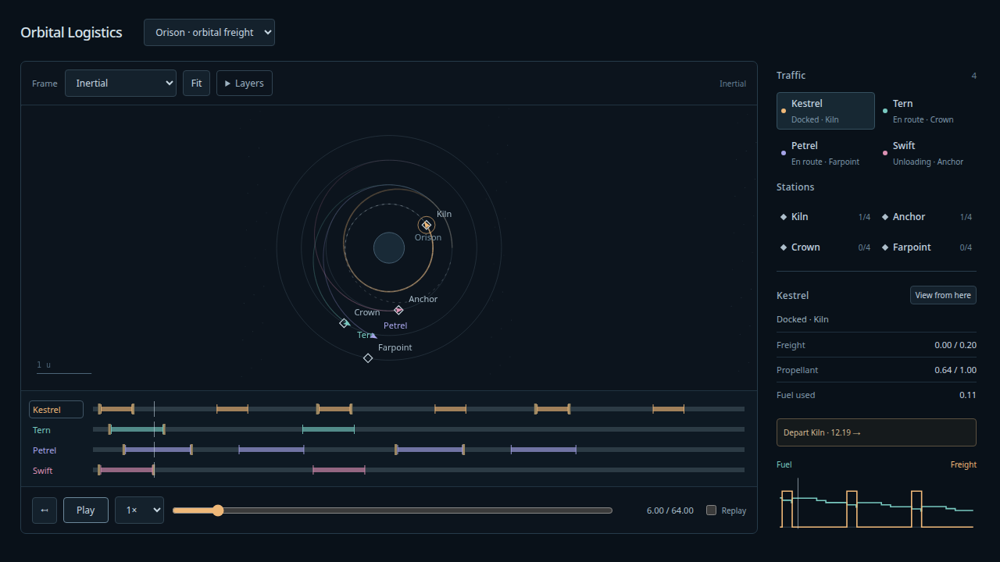
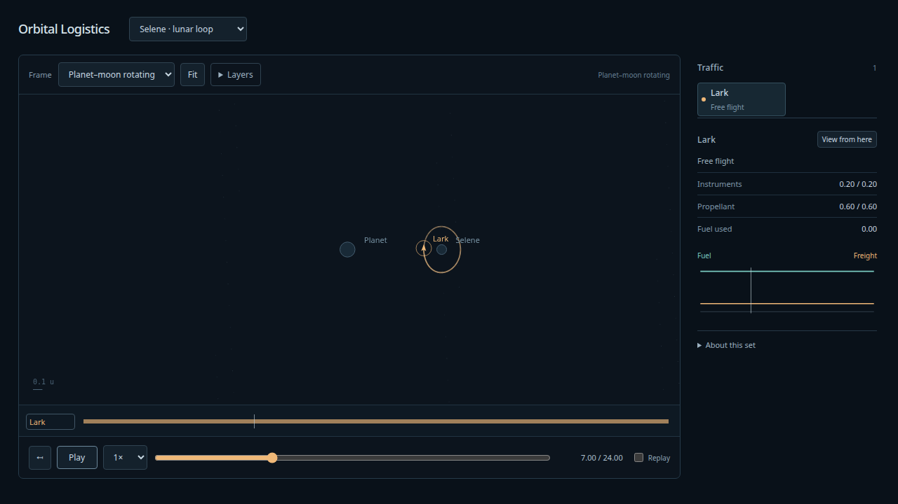

# Initial orbital model-set viewer — 2026-10-08

Host `natto`, branch `codex/model-set-viewer`. User authorized this direction after
reviewing the recovered cross-model consultation. Implementation is available for
hands-on review; no claim of user acceptance of the new viewer yet.

## Implemented

The application now opens the model-set viewer rather than the CoaDE-derived editor.
The previous UI and browser acceptance suite are retained at `c61325a` in history;
the new browser suite tests the current product. Pure simulation/planning/editor-state
regressions remain in the headless suite. Runtime editor DOM modules were removed.

Orison has four named stations on radii 0.8, 1.15, 1.6 and 2.05, and four named ships.
The offline authoring script chooses analytical Hohmann windows, generates explicit
paid departure/capture burns and service operations, and validates every complete
program. Kestrel performs three deliveries, Tern one, Petrel two, Swift one. Every
ship returns to its home station. Cargo is one generic freight mass; station role
labels do not simulate different products or production. Stocks and berths are finite.

Selene is the retained planar DRO in the circular binary fixture, at mass fraction
0.02 and duration24. It is a fictional orbit-family example, not an exact mission.

The viewer supplies inertial, rotating, body/station/ship-centered frames; shared
playback/scrub; a selectable fleet and stations; overlap chooser; pan/zoom/fit; ship
activity lanes; event jumps; fuel/freight traces; layers and clear view. A worker
prepares immutable view samples and ledgers. View transforms use each vertex's epoch,
including the rotation term for velocities. The ship-frame transform avoids cloning
logistics state for every path vertex. Cargo and propellant plots use steps at events.

## Validation

Commands:

```sh
npm run build
npm run test:sim
PLAYWRIGHT_PREVIEW=1 npm run test:browser
npm run evidence:model-set
npx tsx scripts/model-set-fixtures.ts
uv run --project spikes/numerics --group dev --group plots pre-commit run --config spikes/numerics/.pre-commit-config.yaml --all-files
```

- Build/typecheck pass. Production main JS 35.2kB, worker 20.2kB before gzip.
- **71 simulation tests pass**, including five new set tests. These check shared cargo
  conservation, all propellant against burn/capture expenditures, aggregate overdrafts,
  berth contention, incompatible worlds, exact discrete event timing, disposable
  display samples, rotating velocities, object-centered frames and DRO closure.
- **Five production Chrome tests pass**, with no page/console errors: historical scrub
  restores all ships/stocks; frames and layers preserve physical state/events; docked
  overlap chooser and pan/zoom; lunar exploration/finite end/explicit replay; stale
  worker cancellation and safe loading controls; narrow layout without horizontal
  overflow. Some cases cover multiple related interactions.
- The existing independent DOP853/resource replay was extended to accept the new
  four-vessel evidence set. All four programs reach the horizon, every ledger event
  agrees, cargo/port stocks agree, and fuel agrees within1e-11. Maximum sampled
  position error **4.43e-12**, velocity **3.14e-12** normalized units. Tight/regular
  oracle discrepancy ≤1.48e-11. Raw inputs/report are adjacent JSON files.
- The prior DRO independent and app-runner two-step checks are retained under
  `docs/design/orbital-model-set/consultant/experiments/dro/`. Eight-period position
  closure in the app:1.39e-10 at1/512,1.41e-11 at1/1024, through t=24.
- Dense free-flight view interpolation was compared with fresh canonical queries in
  a headless test: position error <0.0003 over the tested freight ship's horizon.
  This is a view approximation, not a physics error bound at arbitrary zoom.
- Layouts were visually inspected at1280×720 and tested at780×860. Readouts and
  budget chart fit the ordinary desktop sidebar; labels try alternate positions
  rather than always overlapping a nearby marker's name.





## Boundaries and follow-up

The simulation state, force model and burn semantics remain planar. Body backreaction
is absent. Logistics remains limited to circular ports around a fixed primary; the
binary scene has no docking or freight service. Prepared overlays have no runtime
handoff/dependency or replanning. Their combined ledger is admitted only if shared
stocks/capacities and berth occupancy pass. No collision/mutual gravity between ships
is modeled, and no general multi-ship scheduler is claimed.

The64/24-unit scenes are finite. Replay resets their initial state and inventories;
it is not physical looping, production, stationkeeping or sustained service. No real
Earth/Mars/Jupiter ephemerides, ground ascent/descent, finite thrust, solar sails, or3D
engine migration is implemented. See [accepted direction](../model-set.md) for those
follow-ups and the coherent3D contract. Potential/energy/porkchop companion views
remain possible extensions rather than hidden calculations in this UI.

The numerical results establish valid prepared motion and accounting, not whether
watching it is compelling. Next step: hands-on viewing and feedback about the scene,
frames, time controls and desired content.
