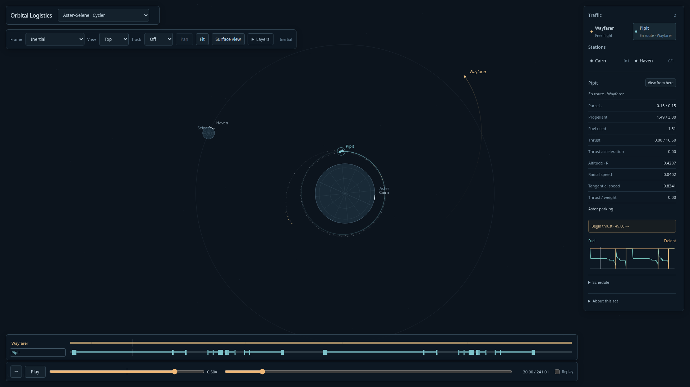
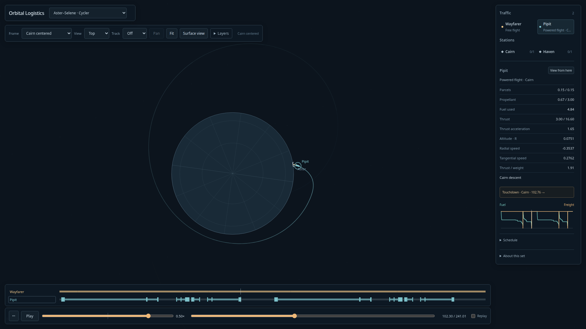
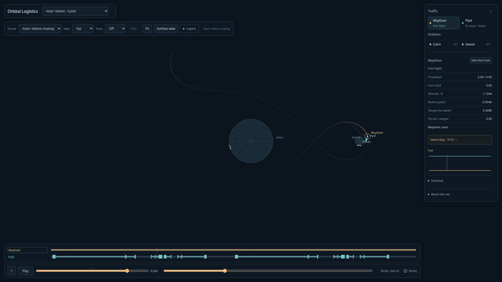

# Finite ballistic cycler service — 2026-10-12

**Aster–Selene · Cycler** now contains the owner-accepted natural pass-through geometry
and two full Pipit parcel round trips. Wayfarer has zero thrust/zero fuel consumption;
there is no Beacon stop or periodic state reset. Pipit launches early, makes more than
four actual Aster parking laps, then uses departure/coast/rendezvous burns. Return
braking, orbital parking and terminal descent are separate physical phases.

The fixture preserves the existing fictional field, airless supported ground ports,
separate tanks, exhaust4 and shuttle4/16.6 acceleration/force limits. All four landings
retain the original .3 reserve. Deliveries/reloads are explicitly paid and funded.
The finite241.009-unit history covers two120.505-unit circuits and four.15 deliveries.

## Verification

- Fresh full-field coupled DOP853 replay, actual absolute carrier/ground targets,
  native interval-exclusion admission and h/h2/h4 calibration pass.
- Baseline212249 advances/212257 enclosures; independent disagreement≤1.3e-9 position
  and≤3.1e-9 velocity across measured native/browser runs, below1e-8. Capture position
  and speed plus allowance each remain below1e-7; all residual velocity is paid.
- First orbital connection costs.3582 delta-v (.0729 departure/.2853 rendezvous).
  Full half-trip costs3.711/4.111; landing fuels.4911/.3349. No global-optimum claim.
- Carrier fuel6 stays constant. Shuttle imports/consumption10.3479 balance, four
  deliveries export.6 cargo, and final shuttle fuel3/cargo.15 close the finite ledger.
- Source1,160,787 bytes; native template approximately2.53MB,17,675 displayed samples,
  complete JSON scene14,996,014 bytes, within the explicit16MB reply bound.
- Source regeneration is byte-identical SHA256
  `17b9899ef817bbb9415ababa05c4d39eeb2985e7b7b20c1c0dab93a29bc4314e`.
- 26 relevant simulation/regression tests plus2 rocket-attitude tests pass. Known-bad
  field/control/metadata/carrier-thrust/funding/reload/calendar and work-exhaustion
  fixtures reject; exact-budget integration reproduces identical healthy rows.
- Both production Chrome browser tests pass: phase scrubbing, paid boarding/release,
  refills, signed rewind, inertial/body/rotating views,3D Follow/Chase, full4K16× playback
  and switching through full Aster–Selene/Solar/new Cycler. No page exceptions.
- Final4K16× sample: draw p95≈12.8ms/max19.7ms, panel p95≈.9ms, frame-gap
  p95≈16.8ms/max33.4ms. This is measured host/Chrome behavior, not every-device guarantee.
- Build/typecheck, Python format/lint/typecheck and pre-commit hooks pass. Astra
  architecture/follow-up findings are dispositioned; main visually inspected parking,
  landing and3D screenshots. Owner viewing of the completed service remains open.

[Current numeric metrics](pass-through-numeric.json),
[browser metrics](pass-through-browser.json),
[contract and reproduction](../design/compact-cycler/redesign/README.md),
[review disposition](../design/compact-cycler/redesign/disposition.md).

The retired Beacon-stop fixtures remain history. Continuous free-carrier service is
a later numerical/resource-boundary slice; finite Replay deliberately rewinds history.
