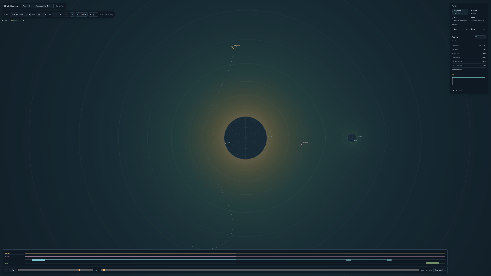

# Compact potential map — 2026-10-12

Implemented the owner-approved scalar-first slice. **Layers → Potential map** is default off and available for compact pass-through/cycler scenes. Fixed logarithmic colors and ten raw-potential contour levels give a topographic presentation; the small legend shows the color endpoints. The same physical XY plane works in Top and oblique 3D, with near-edge-on suppression. Lagrange-like crosses and the owner-approved schematic relief mode remain later work. No simulation or resource algorithm changed.

## Physical and rendering contract

`src/view/potential-field.ts` samples the actual compact direct-gravity potential in the stationary rotating basis. Rendering maps that basis through world at cursor → selected reference frame → camera. Neither cursor changes nor physical-frame changes require new scalar samples. The field excludes physical source interiors, without gravity softening. Boundary-cell tint extends exterior color for raster coverage and is clipped against exact source circles; surface-intersecting cells emit no contours, including a small source enclosed entirely by a cell.

One lazy display worker owns one outstanding request; the next draw replaces desired bounds rather than queuing work. A 256² overview plus at most one 512² detail patch covers close zoom. One independent backdrop canvas is capped at 1280 pixels on its longest dimension, separate from the full-resolution freight canvas. Unchanged projections do not repaint the backdrop; changing projections redraw at the current cursor. This is spatial approximation, not temporal decimation. The renderer preserves valid coarse coverage while a patch is pending and replaces the patch atomically. No general tiling framework, flow particles or vector overlay was added.

Storage accounting includes typed pixel/contour data, canvases, a conservative path allowance and the reserved outstanding worker job; ceiling 16MiB. The final observed retained footprint was 6,707,200 bytes, four sample requests, 8,320 contour segments, no pending job/error. Browser/driver-managed GPU allocations are not a measured memory-residency claim. The finite overview has bounded coverage; areas outside it and the detail patch remain uncolored.

Timeline native corner resizing is replaced with a sticky top grip. Dragging upward increases height with the bottom anchored; pointer capture, cancellation, keyboard arrows/Home/End, height clamps and lane scrolling are preserved. Timeline and field settings remain disposable presentation.

## Validation

- Build/typecheck passed; ten focused numerical/camera/trail tests passed. Field tests check single-source potential, exterior finite-difference force parity, rotational covariance, tiny-body/cell masking, contour exterior geometry, determinism and sampling limits.
- Production browser field test passed at 4K: initial-off behavior, overview/refinement, exact paused ship/stock equality across toggling, Top/3D/front suppression, frame switching, reverse/held/Live, set switching, storage bounds, pointer and keyboard timeline resizing with fixed bottom. Two measured refinement uploads took 1.6–1.7ms. No browser exceptions or service fault/halt.
- Existing continuous-fleet production regression passed at 4K/16× with the new top grip, retaining deliveries, maintenance, rewind/Live and set switching. Original historical evidence artifacts were preserved.
- Own visual inspection covered the Top, Moon close-up and oblique captures. Corrected the initial coarse black rim around bodies. The owner still supplies the visual-taste gate for color strength and contour density.

## Performance envelope

Retained [browser metrics](potential-field-browser.json) include two paired 4K held-playback runs starting at the same epoch, 16× live warm-up, inertial playback, refinement and a 1080p paused comparison. Draw timings include field projection; upload timings are separately recorded. These are this host's headless Chrome measurements, not universal hardware guarantees.

| Mode | Draw p95 | Frame-gap p95 |
| --- | --- | --- |
| 4K held, field off (two runs) | 5.6 / 5.4ms | 16.7 / 16.7ms |
| 4K held, field on (two runs) | 4.3 / 3.5ms | 33.4 / 33.4ms |
| 4K inertial, field on | 6.3ms | 33.4ms |
| 4K close-zoom/refinement, field on | 10.5ms | 33.4ms |
| 1080p paused, field off / on | 2.4 / 2.1ms | 16.7 / 16.7ms |

The proposed ≤3ms incremental draw target passes in the paired steady views. The ≤5ms frame-gap regression target **does not pass at 4K**: compositing the transparent freight over a textured backdrop settles near 30fps despite low JavaScript draw cost. Separating and caching the backdrop improved the initial 50–66ms gaps; no simulation warp cap or full-resolution freight downgrade was introduced. This optional prototype is functionally ready, with the 4K compositor envelope explicitly open. Further rendering work should be justified by owner viewing on the actual client, rather than more solver optimization.

[Moon close-up](potential-field-moon.png) · [Oblique physical plane](potential-field-oblique.png) · [Design/review](../design/potential-field/README.md)
