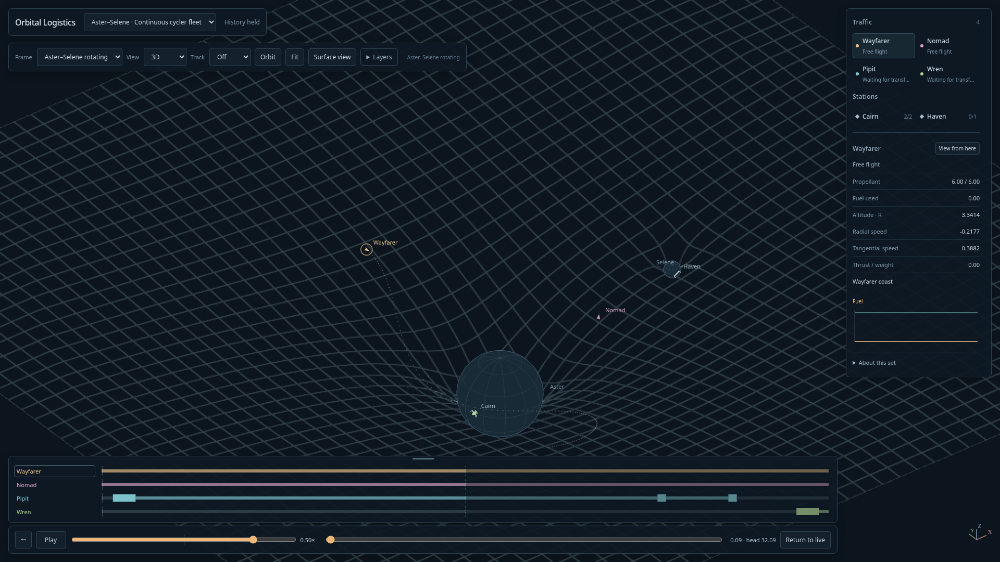

# Transparent relief grid — 2026-10-12

Owner requested relief independent of color/isolines, a rectangular grid, transparency through folded surfaces, profile outlines and a stable height control. These are implemented for the existing compact cycler sets. **Relief** now works without **Potential map**; **Relief grid** independently shows Cartesian lines. Turning Potential map on adds a translucent tint and isolines, rather than an opaque sheet.

Grid coordinates are anchored to the selected physical reference frame. Spacing changes only with zoom, in powers of two; it does not change with the rotating field's projected axis lengths during playback. Height, per-vertex epochs, camera centering and physical/resource contracts are unchanged.

The WebGL backdrop now has an alpha channel, clears to transparent, blends with separate RGB/alpha factors, and does not write/test surface depth. This deliberately renders a transparent diagram: grid/contour strokes from folded or rear portions remain visible. Background-valued fragments contribute no opaque rectangle. Analytic grazing-angle silhouettes and a separately drawn mesh-perimeter line emphasize shallow views. The ordinary flat map gets a boundary hint when shallow and an outline-only plane at edge-on angles; it no longer silently disappears there.

The height/trail controls use fixed grid columns and a six-character, tabular multiplier slot. The slider spans its own complete row. A stable scrollbar gutter avoids width changes in the Layers popup.

## L4/L5 decision

The owner explicitly chose to defer L4/L5 until the dynamics support them; no geometric substitutes were added. The current compact field keeps Aster fixed and omits primary-origin acceleration. The ordinary circular restricted problem instead uses the mutual orbital motion of the two primaries; see [NASA's center-of-mass derivation](https://pwg.gsfc.nasa.gov/stargaze/Slagrng3.htm). Its triangular equilibria must not be inferred from this set's direct gravitational potential. The three previously computed rotating equilibria remain unchanged. Any future correction of the force model needs separately versioned/revalidated trajectories rather than silently changing these prepared sets.

## Verification

- Build/typecheck and thirteen focused field/camera/trail tests pass.
- Five production browser tests pass: flat field and edge-on outline, independent grid/relief/tint toggles, physical state/stock equality, paused/frame/Follow/reverse/Live/set switching, unavailable-WebGL fallback, and mode switching during delayed refinement.
- A GPU readback taken immediately after drawing found 455,140 fully transparent pixels, 134,684 partially transparent pixels and zero opaque pixels in the initial grid-only frame. The context confirms alpha enabled, blending enabled and depth testing disabled. This directly catches the prior opaque-backdrop behavior; it is not a GPU-memory-residency claim.
- Height values 0, 0.05, 1, 1.05, 2.95 and 3 preserve the slider's x/y/width within 0.5px. The baseline Clear view assertion now includes all current layer keys.
- Observed logical field footprint 7,240,844 bytes remains below16MiB. Boundary indices add at most9,280 bytes to the prior mesh allowance; simulation storage is unaffected.
- Own visual checks covered the grid-only oblique view, colored grid and Front profile. Full4K performance remains bounded by the existing compositor envelope; this pass does not certify60fps at4K.

Existing first-slice and first-relief screenshots/metrics are preserved. [New readback evidence](relief-grid-browser.json).

[Profile outlines](relief-profile.png) · [Optional color and isolines](relief-grid-color.png)
