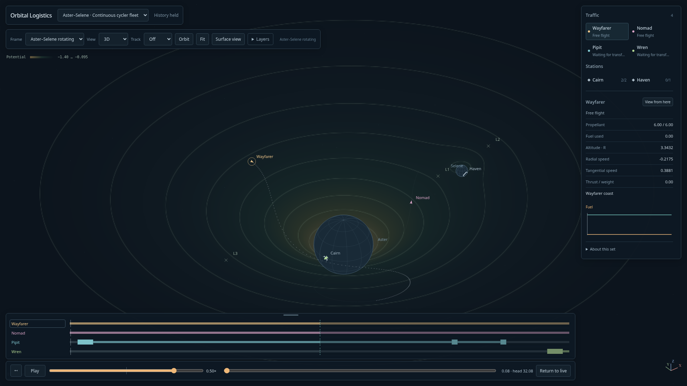

# Potential fade, relief and equilibria — 2026-10-12

Owner accepted the flat field, requested darker contrast/natural fade, and authorized the schematic sheet with objects riding its height. Compact cycler sets now offer **Layers → Relief**, a **Height** slider (0–3×), and independent **Lagrange points**. Entering relief from Top chooses the oblique camera. Near-edge-on relief remains available as a profile view; the ordinary flat map still suppresses edge-on projection. The layer menu scrolls on short displays.

## Fade

Low potential magnitude reaches exactly the existing background RGB(12,20,29), with a fixed logarithmic transfer from magnitude .095 to 1.4 and a darker palette. The entire ±12 overview boundary is below the .095 cutoff; contour magnitudes begin at .1 and close inside it. Thus no rotating square edge is visible in inertial/body-centered views. No time/zoom normalization or change to gravity was introduced. [Flat capture](potential-fade.png).

## Schematic relief

A separate, lazy WebGL2 canvas renders a bounded height mesh, with more vertices near the two bodies. Its shader evaluates the same fixed color/contour law analytically. Synthetic height is `−2.4 × logTone(Φ) × gain`; interior radius clamps only place schematic body centers and never soften the actual force. Source interiors are masked. The backdrop is capped at 1024 pixels on its longest dimension, while foreground glyphs remain full resolution.

Every displayed ship/trail/route vertex gets that height at its own epoch before frame projection. Named frames subtract their origin's synthetic height, and Follow/selected-pivot controls use the same displayed positions. Body glyphs remain schematic spheres. Inspector states, velocity/attitude axes, forces, fuel, stock and canonical event times remain physical. Relief is a scalar-energy diagram with intentionally artificial altitude, not GR curvature or a new simulation surface.

Coverage inverts the complete allowed height slab rather than the physical zero-height plane, so close Follow cannot leave its underlying surface outside the patch. The bounded overview supplies coverage when a refinement would be too broad. Entering relief cancels pending flat sampling and drops its detail cache; analytic GPU rendering requires no CPU sampling job. Ordinary-map return releases the relief framebuffer. Logical field allocations retain the 16MiB ceiling; graphics-driver residency remains outside that claim. WebGL unavailability/context loss falls back to the ordinary map without stopping traffic.

## Equilibrium crosses

The three crosses solve the actual compact rotating acceleration `g + n²(x,y) = 0`:

| Marker | Rotating x | y |
| --- | --- | --- |
| L3 | −4.963233131143511 | 0 |
| L1 | 3.995359600545843 | 0 |
| L2 | 6.123129239772423 | 0 |

These are model-specific Lagrange analogues, not imported barycentric CR3BP coordinates. For this fixed-primary force, `F_y=yB` and `F_x=xB+.15/m³`, where `B=n²−1/r³−.03/m³`. A nonzero y would require B=0, leaving positive F_x, so there are no L4/L5 equilibria in this prescribed model. No stability claim is made. Markers follow the rotating source configuration in any selected frame; label visibility and sphere occlusion apply normally. Colors/height still show ordinary gravitational potential rather than the centrifugal effective potential.

## Validation

- Build/typecheck and thirteen focused field/camera/trail tests pass: force-gradient parity, rotation, exterior masks, deterministic bounds, background endpoints, bounded relief, canonical-gravity equilibrium residuals (<1e−12), and close Follow slab coverage in inertial/named-height origins.
- Production flat-map regression passed at 4K, including timeline grip, held/reverse/Live, refinement and set switching. Its historical first-slice captures/metrics are preserved.
- Three production relief browser tests pass: live16× at1080/4K; body/rotating/inertial/front views; height adjustments; close Follow with surface-coverage assertions; scrub/reverse/Live; state/stock equality across toggling; set switching; unavailable-WebGL fallback; and relief entry while a delayed 512² flat request is outstanding.
- Final logical retained relief footprint: 7,231,884 bytes, zero sampling requests/pending jobs, no field/service errors. Own visual checks confirmed the fade and removed the initial coarse lunar-well notch by concentrating vertices locally.
- Astra's two P2 findings were fixed with explicit regressions: [disposition](../design/potential-field/relief/disposition.md). The reviewer inspected source and ran small projection/storage reproductions, not a GPU performance validation.

The retained [browser profile](relief-browser.json) measured1080p/16× draw p95 7.4ms and frame-gap p95 16.8ms. A subsequent live4K/16× segment measured draw p95 7.3ms (max9.4ms), frame-gap p95 50ms (max50.1ms), about30 frames/s over the segment. No planning pauses or service faults occurred. Full-resolution 4K compositing remains the main performance limit; this does not establish60fps at4K or GPU-memory residency. Owner viewing remains the color/height taste gate.

[Moon close-up](relief-moon.png) · [Inertial view](relief-inertial.png)
