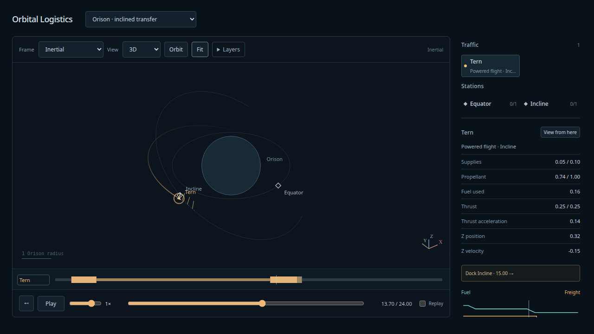

# Smooth finite steering and see-through bodies — 2026-10-08

The user accepted the 3D controls and requested optional transparent bodies, smooth
steering and a spatial finite-thrust set. [Design and scope](../design/smooth-steering/README.md)
record the physical law and illustrative unit scaling. This is implementation and
agent validation evidence; choreography/readability remains a human viewing gate.

## Delivered behavior

Layers → **See-through bodies** starts unchecked. Enabling it fades body fills and
outlines and reveals rear paths, labels and selectable markers; projected overlaps
use the existing chooser. Turning it off restores spherical occlusion. It persists
across scene/camera switches without changing physical state or time.

**Orison · inclined transfer** carries 0.05 freight from an equatorial radius-2 depot
to a radius-3 depot inclined 35°. Tern flies two smoothly steered finite arcs with a
coast between them. There are no authored impulses. It docks at t=15, unloads by
15.3 and dwells through 24. The legacy return-goal metadata is unused; this is a
one-way exhibit, so the independent report's `complete:false` is expected.

Programs containing steering require schema 4. Scenario, dynamics and snapshots
retain v3. Older readers reject the new program; current readers reject steering
in schema-3 programs. Fixed-heading programs preserve their previous arithmetic.
Physical RK stages, current thrust indicators and future whiskers evaluate the same
C1 spherical heading law. This is actual continuous steering, not a display-only lerp.
Existing accepted surface/continuous flights retain their fixed-heading programs;
retargeting those flights is separate work.

## Reproduction and checks

Run from the repository root:

```sh
npm run build
npm run test:sim
npm run test:browser
npm run evidence:steering
npm run evidence:propulsion
npx tsx scripts/steering-fixture.ts --check
uv run --project spikes/numerics pre-commit run --all-files --config spikes/numerics/.pre-commit-config.yaml
```

Build/typecheck, **134 simulation tests**, **23 production installed-Chrome tests**,
fixture byte reproduction and configured Ruff format/lint/ty hooks pass. The legacy
finite-propulsion oracle also passes with the extended independent implementation.
New checks cover unit headings, C1 turns, rotational equivariance, schema rejection,
immutable keys, exact canonical key boundaries, query partitioning, snapshot replay,
paid depletion/surface-stop prefixes, rotated continuous templates, finite arrival,
display heading and browser whisker projection. See-through tests check rear-marker
selection, overlap choice and restored occlusion without changing simulation truth.

[Oracle input](steering-oracle-input.json) preserves the scenario, program and sampled
results for h=1/32, 1/64, 1/128, 1/256, 1/512, 1/1024 and 1/2048. The independent
seven-state DOP853 replay uses a separate tangent/Rodrigues spherical heading formula
and evolves fuel independently. It checks resources, events and event-left arrival;
canonical safety certificates cover every flight interval against an enlarged
radius-1.5 primary. The [report](steering-oracle-report.json) retains all measurements.

The first three position-error refinement ratios are 17.36, 17.68 and 18.42; the
finest runs reach the numerical floor. At production h=1/1024, pre-capture position
and speed residuals are 4.094e-14 and 1.733e-14, with 9.728e-15 fuel explicitly paid
for capture. The independent pre-capture errors are 5.463e-14 and 3.640e-14. The
independent ordinary/tighter integration refinement differs by at most 9.329e-13.
Coarse runs pay their own larger capture corrections; resource comparisons account
for that paid residual rather than assuming free velocity matching.

Tern begins with 0.9 propellant and retains 0.634119665507 after arrival. The braking
arc reaches the 0.14 acceleration cap at 13.744810249711104 and thereafter tapers
force as mass falls. The engine's illustrative physical scale is 250 N, 0.14 m/s²
maximum acceleration and 3 km/s exhaust velocity; burns last roughly 26/28 minutes.
This fictional scale is not a real mission or spacecraft calibration.

[Display measurements](steering-display.json) compare 2,055 retained samples and
quarter/mid/three-quarter drawing queries with the canonical Runner. Maximum full
3D position interpolation error is 4.182e-6 world units, bounding orthographic error
by 0.002091 px at 500 px/radius, plus ≤0.1 px path compaction. Heading discrepancy
is zero because display uses the physical law. This does not claim accuracy at
arbitrarily large zoom.

## Visual inspection

Production Chrome inspected and captured the oblique inertial view during braking.
The in-app browser separately loaded the new set, scrubbed to 13.7, inspected the
transparent body option and restored occlusion. It is left paused there at 0.5× with
Replay enabled. No warnings/errors were captured in the successful app session.
An earlier preview service had stopped; restarting it and opening a fresh tab
restored access. That browser recovery is separate from application validation.



General feedback guidance, attitude/gimbal limits, throttle ramps, surface-route
retargeting, maintained targets, atmosphere and staging are not implemented here.
No new external design review is claimed.
