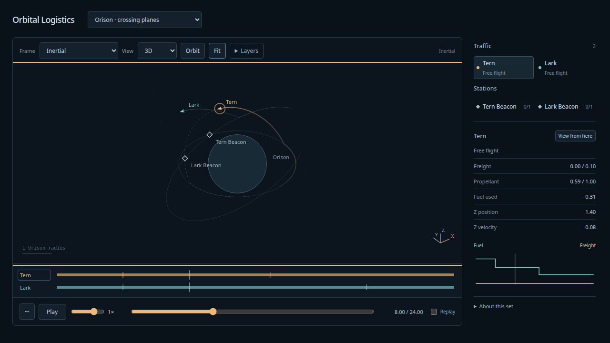

# Orthographic 3D viewer — 2026-10-08

The user selected 3D viewer/controls before stationkeeping, with simple noncoplanar
maneuvers as the validation gate. The existing Canvas2D schematic now projects the
full spatial state through an independent orthographic camera. Top preserves the
familiar overhead view. [Contract](../design/spatial-viewer.md),
[fixture](../../fixtures/model-sets/crossing-planes.json),
[generator](../../scripts/spatial-viewer-fixture.ts).

## Reproduce

```sh
npm run build
npm run test:sim
PLAYWRIGHT_PREVIEW=1 npm run test:browser
npm run evidence:spatial-viewer
npx tsx scripts/spatial-viewer-fixture.ts --check
uv run --project spikes/numerics --group dev --group plots pre-commit run --config spikes/numerics/.pre-commit-config.yaml --all-files
```

128 simulation tests and 21 installed-Chrome production browser tests pass, along with
TypeScript/build and configured Ruff format/lint/ty hooks. The generator byte-check
passes. No simulation/worker/storage code changed.

Three camera geometry tests check orthonormal handedness, exact Top/XY compatibility,
Front/Side axes, camera-plane pan/cursor zoom, scale limits/pole wrapping, and sphere
visibility for front/back, limb, silhouette/surface crossings and multiple bodies.
Two spatial-scene tests check real plane changes, paid event sides, final-plane
restoration, nonzero Z and immutable frame/camera queries.

Three new browser tests exercise orbit, Shift-pan, explicit Pan mode, wheel zoom,
Fit preserving orientation, keyboard controls, camera presets, physical frame switching
and unchanged ship/resource/event state. Rear markers and labels disappear behind
Orison and cannot be selected through it; the foreground body is pickable. Returning
overhead reveals the ship. Visible projected ship/beacon overlaps open the chooser.
Projected exhaust whiskers independently agree with the camera basis and force scale.
Continuous surface history remains unchanged under camera switches, Surface view
returns Top/close scale, and fixed/continuous/spatial set switches produce no page
errors. The original 18 browser checks retain speed/layer/label/launch/landing, rolling
history eviction, Live/Restart and stale-worker asset coverage.

Early focused control checks caught two test assumptions: Shift-pan does not toggle
the persistent Pan mode, and the published diagnostic state is throttled during a
drag. The final test explicitly exercises the toggle and waits for the final angle.
These did not require changing the camera gesture semantics.

## Noncoplanar physical witnesses

**Orison · crossing planes** runs Tern at radius 2 and Lark at radius 2.8 through 24
normalized time units around a fixed μ=1, radius 1 primary. At t=4, Tern changes from
0° to 45° signed plane tilt about node azimuth 0; Lark changes from −30° to +25° about node
azimuth 0.9 rad. Each restores its original plane at the opposite node, at
t≈12.885766 and 18.719236 respectively. Two analytical beacons remain on their
original orbits. All four Cartesian impulses consume real rocket fuel; no docking,
free capture, target relocation or spatial transfer solver is involved.

[Raw production input](spatial-viewer-oracle-input.json),
[independent report](spatial-viewer-oracle-report.json). Two ships × h=1/512,1/1024,1/2048
are compared at 241 regular epochs plus exact events. The Python oracle independently
integrates all six components with SciPy DOP853 and applies its own rocket equation.
A second, closed-form piecewise circular solution propagates its own anchors from
the initial state and raw Cartesian impulses, independent of the numerical oracle.
Event-left/right states and ledger fuel agree. Every production coast interval has
a canonical safety certificate and both runs reach the horizon.

Across all six cases, maximum full six-state norm disagreement with tight DOP853 is
1.094e-12; fuel disagreement 1.67e-16. Closed-form versus tight oracle disagreement is
2.762e-13; ordinary-versus-tight oracle refinement is 2.250e-11. Errors at these steps
are effectively at the roundoff/oracle floor; this fixture does not establish a
fourth-order convergence slope. The angular-momentum normals change 45°/55° and return
to the original planes within 1e-10. Remaining fuel is 0.3245284192 for Tern and
0.3151145660 for Lark.

## Drawing and live inspection

[Display report](spatial-viewer-display.json) checks quarter/mid/three-quarter queries
of every disposable drawing segment against the canonical Runner:2,051 samples per
ship, max full 3D positional error 4.292e-6 units. Any orthographic projection is bounded
by that full 3D norm: 0.002146px at 500px per radius, plus the renderer's ≤0.1px path
compaction. This is a fit-scale guarantee for this witness, not an extreme-zoom claim.

[Browser timing](spatial-viewer-browser.json) records continuous surface service paused
at historical cursor 9.9 in oblique view: median/p95 frame intervals 16.7/16.7ms in this
local production headless Chrome run. It is a diagnostic rather than a portable
performance guarantee. Existing close surface sampling/rolling budgets are retained.

The in-app production preview was refreshed and inspected at t=8. Keyboard rotation
changes View to Custom, overhead reset and the 3D preset work, and the scene is left
paused at 0.5× with Replay checked. Numerical agreement does not establish human
camera feel or spatial readability; those remain the user's next viewing gate.



## Scope

Orthographic orbit/pan/zoom, spherical body occlusion, projected headings/exhaust,
reference frames, layers and scrubbing are implemented. The spatial witness uses
impulses to isolate geometry; existing finite propulsion projects unchanged. Variable
steering/whisker smoothing, arbitrary ground latitude/spin axes, maintained stations,
atmosphere and staging remain deferred. No new external design review is claimed.
