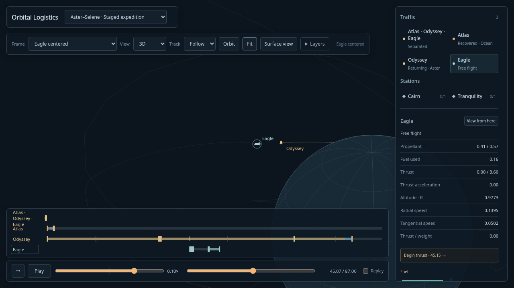
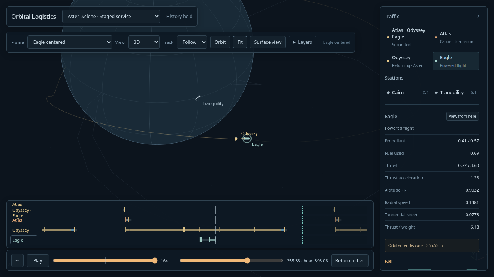

# Staged expedition validation

The initial witness measurements below are historical. The current fixture and
JSON reports include the [2026-10-11 refinement](staged-refinement.md),
with new lunar controls, inventories and measured numerical checks.

2026-10-11, natto. The two new selectable exhibits are
**Aster–Selene · Staged expedition** and **Aster–Selene · Staged service**.

The finite flight launches an atmospheric booster carrying Odyssey and Eagle.
Atlas separates and recovers independently; Odyssey carries Eagle to Selene,
then coasts in a real parking orbit while Eagle lands, waits, ascends and
rendezvous. A paid residual capture attaches Eagle to Odyssey for the atmospheric
return. The continuous exhibit retains all three hardware inventories, hides
supported ground turnaround and imports each tank's measured fuel deficit before
the next synodic departure. One physical compilation serves the repeated missions.

## Verification

- Production build and TypeScript checks passed.
- Full simulation suite: **251 passed**, zero failed; 305.46 seconds.
- Production browser checks passed for the finite and continuous staged missions,
  Beacon relay, and all five responsive viewport cases (3840×2160, 1440×900,
  1024×768, 390×844, 320×640).
- Continuous browser playback covered three trips and refills at 16×, held
  scrubbing, attached Eagle-centered Follow, replay, return to live, and switching
  between Beacon, finite staged flight and continuous staged service.
- The older single-vehicle expedition regression initially reached its 60-second
  total test timeout at the final set switch while the full simulation suite was
  running. Its isolated production rerun passed in 22.8 seconds without increasing
  the timeout or changing production behavior.
- Independent whole-graph DOP853 flight checks passed for cycles 0, 17 and 9000.
  The reference derives every stage from the initial pad state and original
  tanks; the global 1e-4 accuracy gate is supported by h/h2/h4 refinement.
  Physical landing/docking capture limits remain 2e-6.
- Continuous accounting reached epoch 1,000,000 and 9,672 supported refills.
  Aggregate fuel balance error was 7.28e-12. Physical context, drawing storage,
  packets and materialization work remain bounded independently of trip count.
- Astra reviewed the fixed topology, mass/tank ownership, actual-target docking,
  recovery, recurrence and numerical reference discrepancy.

The desktop viewer fills the browser viewport beneath floating controls,
inspector and timeline. Narrow screens keep a stacked, scrollable layout.
The resize tests exercised actual canvas picking, camera movement, timeline seek
and layer controls. The responsive layout is committed separately.

A position-only camera/trail query removed repeated telemetry cloning and entry
force evaluation from every projected path point. In a bounded headless Chrome
1440×900 test, Eagle-centered Follow improved from roughly 3–4 fps to 34 fps and
kept up with 16× playback. Inertial playback remained about 59 fps. These are
local measurements, not a hardware-independent frame-rate guarantee.

## Retained evidence

- [Finite compiler report](staged-apollo.json)
- [Independent numerical accuracy and refinement](../design/staged-apollo/oracle-accuracy.md)
- [Continuous resources and storage](continuous-staged-apollo.md)
- [Viewer timing](staged-viewer-performance.json)
- [Astra review](../design/staged-apollo/astra-review.md)
- [Responsive viewer checks](full-browser-viewer.md)

The screenshots were visually inspected for launch, lunar approach, rendezvous
legibility and floating layout. Automated checks and agent viewing are distinct
from the owner's next visual acceptance.
