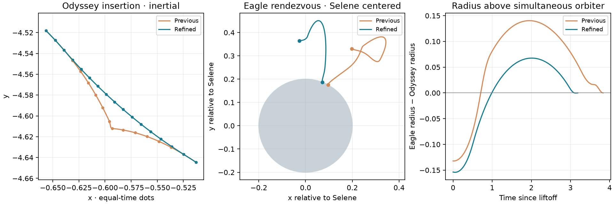

# Smoother staged missions and bidirectional playback

2026-10-11, natto. Both finite **Staged expedition** and continuous **Staged service**
use the same refined physical mission. Bodies, mass ratios, engines, atmosphere,
capture limits and continuous recurrence rules remain unchanged.

| Observable | Previous witness | Refined witness |
| --- | ---: | ---: |
| Odyssey insertion burn duration |0.10749 |0.95861 |
| Insertion peak acceleration |3 |0.20764 |
| Insertion propulsive delta-v |0.32246 |0.19661 |
| Insertion thrust turn |173.7° |25.35° |
| Minimum inertial speed during insertion |0.06373 |0.15216 |
| Eagle ascent/docking propulsive delta-v |2.06058 |0.91670 |
| Maximum Eagle radius excess over simultaneous Odyssey |0.14033 |0.06761 |
| Minimum coast lunar angular momentum |−0.02417 |+0.01872 |
| Eagle first/final burn turn |301.6° /346.0° |26.45° /124.66° |

The insertion joins the same downstream ballistic state at30.35, with its actual
new fuel mass. Eagle's delayed liftoff42.18389 and rendezvous45.37020 give a prograde
coast rather than the previous reverse-direction loop. Some radial overshoot remains;
this is a coherent paid transfer, not an enforced perfectly circular path.

The [combined admission](../design/staged-refinement/combined-admission.json)
measures landing position/velocity residuals6.08e−8/1.35e−7 and docking residuals
4.98e−9/5.23e−9, inside unchanged2e−6 gates. Independent full-graph DOP853 replay
passes at cycles0,17,9000: maximum sampled state error is2.49e−5 and maximum
recovery-epoch error5.17e−5, inside the unchanged1e−4 global numerical allowance.

| Canonical step | Orbiter recovery epoch |
| --- | ---: |
|1/1024, production |79.507471467718 |
|1/2048 |79.507423918748 |
|1/4096 |79.507420015498 |
|Tight DOP853 |79.507419863100 |

Successive canonical epoch changes fall from4.75e−5 to3.90e−6; h/4 is1.52e−7
from the tight independent reference. Retained [h/2](../design/staged-refinement/convergence-2048.json)
and [h/4](../design/staged-refinement/convergence-4096.json) runs propagate the
complete graph from the original pad/tanks and independently pay captures.
The original accuracy study remains historical in `docs/design/staged-apollo/`.

Continuous accounting again reaches epoch1,000,000 with9,672 supported refills
and zero measured terminal fuel-balance error. Updated per-trip fuel deficits are
Atlas1.5815223, Odyssey1.7503360 and Eagle0.1767293, totaling3.5085876 under the
four-unit import cap. Physical nodes100,677, storage30.88MB and drawing15.21MB
remain under existing limits. [Current finite report](staged-apollo.json),
[continuous report](continuous-staged-apollo.json) and
[independent replay](staged-apollo-oracle-0.json) contain current measurements.

The wider speed control now spans reverse →0×→ forward with fine resolution at
slow speeds. Zero pauses; moving away resumes. Double-click centers it. Continuous
reverse traverses retained history without undoing the canonical simulation,
resources or planning. It stops at the oldest retained epoch; Live resumes forward.
Finite Replay wraps in either direction. Absolute speed caps still vary by set.

[Astra disposition](../design/staged-refinement/disposition.md) records adapted
shape targets, bounded search scope and transport verification.
[Authoring reproduction](../design/staged-refinement/arrival-reproduction.md) and
[Eagle search](../design/staged-refinement/lander/README.md) retain frozen baselines
and selected programs. [NASA/JPL reference analysis](../design/mission-reference/README.md)
retains one compact real trace and Apollo11 event geometry for offline comparison.

The geometry figure samples both missions with the canonical compiler. Equal-time
dots show the original insertion slowdown; the Selene-centered view and radial
comparison expose the original lander loop. Reproduce with `node --import tsx
docs/design/staged-refinement/shape-evidence.ts`, then `uv run --project
spikes/numerics --group plots python docs/design/staged-refinement/plot_shapes.py`.

Validation included the production build/typecheck; seven finite mission tests
(including new trajectory-shape guards), five continuous ownership/storage tests,
and the speed mapping test. Production Chrome exercised finite staging, three
continuous staged trips at16×, five viewport sizes, frame/layer/seek controls,
reverse/zero/replay/history/Live, in-flight reply holds and set-specific speed memory.
The retained browser runs are split across `browser-final.log` (17 passed before a
test-helper formatting correction), `browser-recheck.log` (all5 formerly blocked
cases passed), and `playback-recheck.log` (4 final reverse/cap/memory cases passed).
Early browser failures were malformed range-input test strings and stale assertions
that assumed speeds carried between sets; existing viewer policy remembers each
set's speed. Tests now exercise that policy and physical rates directly.
Ruff format/lint and ty pass for all new Python tools and are included in the
numerical pre-commit hooks. No full simulation-suite rerun is claimed for this pass.
