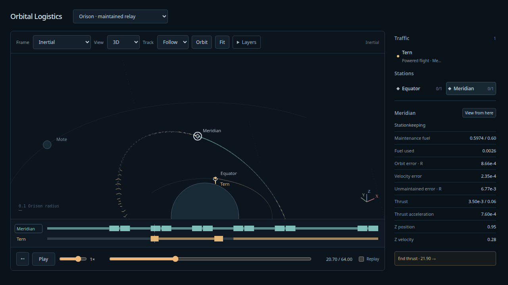

# Maintained relay and tracking cameras — 2026-10-08

The user accepted the inclined finite-transfer set, then requested Follow/Chase,
selected-object orbiting and stationkeeping with Astra high-level review. The
[verified review and contract](../design/stationkeeping/README.md) and
[disposition](../design/stationkeeping/disposition.md) record the adopted scope:
finite paid maintenance of orbital geometry, allowing phase drift, followed by
actual-target arrival/dwell/release. No cargo or fuel exchange occurs at this relay.



## Physical and authoring witness

**Orison · maintained relay** runs for 64 normalized time units. Meridian's nominal
radius-3 orbit is inclined 35°; Mote perturbs it. The station owns fixed dry/ballast
mass 4, initial maintenance fuel .6, exhaust velocity 3, maximum force .06,
acceleration cap .012 and reserve .3. Its target Runner pays every correction and
is admitted over the complete horizon before the visitor executes.

Eight bounded offline checks produce six corrections and two deadband skips. The
original four-check attempt exceeded the declared envelope; its
[failure report](../design/stationkeeping/search-failed-envelope.json) is preserved.
The accepted cadence stays within the original envelope and eight-check ceiling.
The [successful report](../design/stationkeeping/search-report.json) includes a
changed-initial-state regeneration and explicit solve-budget/reserve failures.
No maintenance controller or optimization runs during viewing or scrubbing.

The accepted frozen program uses .020937965796127 station fuel, leaving
.579062034203873. Dense observed phase-free position error is .00236569655
against the .02 envelope. Position/velocity deadbands are .001/.0003 and the velocity
envelope is .005. Authoring samples report maximum velocity error .001410947.
These are observed envelope checks; interval-certified body clearance is separate.

Tern leaves the independently ballistic Equator at 20, arrives at Meridian at 34,
dwells until 36 and releases at the start of the next correction. It retains .05
cargo throughout and finishes with .633922006390391 fuel. Corrections continue
after the visit. The old delivery/return objective remains unused metadata and is
incomplete; this scene demonstrates a relay visit, not a completed delivery puzzle.

## Independent replay and convergence

[Raw oracle input](stationkeeping-oracle-input.json),
[oracle report](stationkeeping-oracle-report.json) and
[display report](stationkeeping-display.json) retain the measurements. Independent
seven-state DOP853 integrates the station's force and fuel, then uses that actual
target for visitor docking. The oracle does not use TS RK steps or anchored fuel
integration. The same frozen controls replay at five steps, 1/32 through 1/512,
without retargeting. Ordinary/tightened oracle disagreement is at most 2.216e-11
position units. The first visitor position refinement is 16.38×; fine steps reach
the independent numerical floor.

At production h=1/256:

| Check | Maximum / value |
|---|---:|
| Visitor position disagreement | 2.454e-12 |
| Visitor velocity disagreement | 5.071e-13 |
| Station position disagreement | 5.080e-13 |
| Station velocity disagreement | 1.017e-13 |
| Station fuel disagreement | 1.888e-15 |
| Pre-capture position residual | 2.682e-12 |
| Pre-capture velocity residual | 5.131e-13 |
| Paid residual capture fuel | 2.880e-13 |

Independent pre-capture position/speed are 3.558e-14/1.138e-14. Scalar resource
comparisons include each run's explicitly paid numerical capture residual; no free
capture correction is assumed. Replacing the target with either the nominal clock
or an unmaintained trajectory misses the required arrival gate.

Every canonical target interval passes powered clearance certification. Full-horizon
admission rejects physical faults, depletion/reserve failure and incomplete target
coverage. Requested epochs require exact valid physical states; display interpolation
cannot enter the target provider. Save/restore, query partitions and changing target
programs are covered. The full provider definition is immutable in the visitor bundle.

## Presentation and budgets

The station has one shared presentation record: actual fuel, thrust, ledger,
boundaries and trajectory. Its station marker, inspector, timeline, exhaust whiskers
and selected route use that record. Orbits adds nominal geometry and an independently
propagated unmaintained comparison from identical initial conditions.

Quarter/mid/three-quarter probes of every display interval measure at most
3.411e-6 station and 3.087e-5 visitor position error: .001706/.015435 pixels at
500 pixels per primary radius. Renderer compaction adds at most .1 pixel. These are
fit-scale bounds, not an arbitrary extreme-zoom guarantee.

The scene retains 4,113 station and 2,053 visitor samples in about 4.27 MB of UTF-8
JSON, below the 8 MB packet ceiling. Admission permits one powered relay, one
ballistic origin and at most two visitors. Powered/aggregate target grid ceilings
are 32,768/65,536; aggregate nominal preparation plus event allowances is bounded
at 262,144. Each Runner retains its separate 65,536-node ceiling. These finite
budgets do not establish a continuous maintained-station cache.

[Tracking contract](../design/camera-tracking.md) defines Follow at the current angle,
deterministic Chase and selected-object orbit pivots. Browser checks verify close
zoom in an inertial frame, unchanged six-state truth across camera/frame changes,
rewind identity, frozen Off, scene reset and pivot preservation. Unit checks include
zero/radial states and orthonormal rigs. Physical-frame and per-vertex epoch
transformations are unchanged.

## Verification and boundaries

Build/typecheck, **140 simulation tests**, configured Ruff format/lint and ty,
fixture byte identity and both stationkeeping/legacy propulsion independent oracles
pass. **26 production Chrome browser tests** pass on the final full run. The final
metadata-admission guard was followed by the five stationkeeping tests and three
focused camera/relay browser tests.
New checks cover docking at burn endpoints, release at burn start, attached overlaps,
legacy hidden fields/version rejection, expired/unsafe/depleted targets, work limits,
immutability, target changes and displayed-versus-physical independence.

The first full browser pass had 25/26 passing: a repeated legacy set-switch check
unexpectedly observed the default set. Three isolated repetitions then passed;
no cause was established and no speculative runtime change was made. The final full
26-test run passed. Follow, Chase and the new set were also inspected in the
in-app browser with no captured warnings/errors. Screenshot artifacts were inspected.
Human camera feel and scene choreography remain a viewing gate.

```sh
npm run build
npm run test:sim
PLAYWRIGHT_PREVIEW=1 npm run test:browser
npm run evidence:stationkeeping
npm run evidence:propulsion
uv run --project spikes/numerics python spikes/numerics/stationkeeping_search.py
npx tsx scripts/stationkeeping-fixture.ts --check
uv run --project spikes/numerics --group dev --group plots pre-commit run --config spikes/numerics/.pre-commit-config.yaml --all-files
```

The independent authoring command writes the frozen successful search report; it is
not part of normal playback. The retained review transcript and search failures are
small durable design evidence. No background optimizer/reviewer remains running.
Runtime-adaptive maintenance, maintained-relay exchange/shared attached mass,
continuous dispatch, station resupply, attitude limits and persistence remain later
architecture slices.
