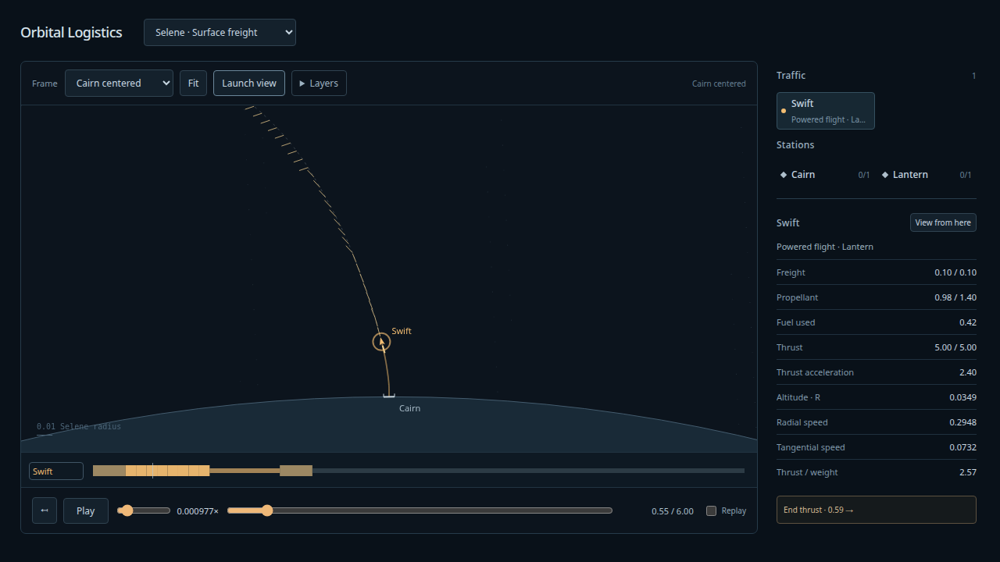
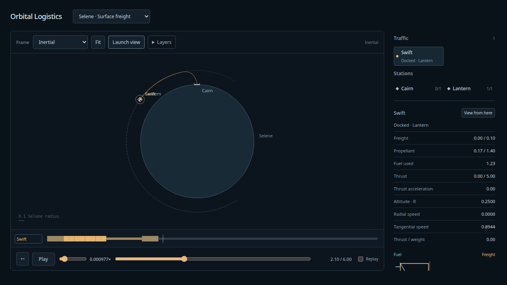

# Airless surface freight — 2026-10-08

Implemented following the requested [Astra senior review](../design/surface-ascent/README.md).
**Selene · Surface freight** is one finite airless, in-plane ascent: Cairn loads Swift,
Swift launches with the pad's rotation velocity, eight finite fixed-heading arcs lift
and insert it into Lantern's orbit, then cargo unloads and the ship remains docked.
The frozen [set](../../fixtures/model-sets/selene-ascent.json) follows the same physics,
propulsion, ledger and resource semantics used by prediction/replay. No user maneuver
editing, runtime steering, instantaneous authored impulses or free capture are involved.

## Verified

- `npm run build`: TypeScript and production Vite build pass.
- `npm run test:sim`: **110 pass**. Seven dedicated surface cases cover analytical
  support/loading, nonzero epoch/physical spin, exact initial attachment, atomic
  service-completion/launch/start, inherited velocity and zero instantaneous fuel
  change, weak/sideways/zero-throttle/capped/empty launch rejection, unfinished
  service, ordinary-undock/later-landing rejection, legacy surface-field gates,
  deterministic queries/partitions and before/at/after-launch snapshots. Rejected
  launch retains support and launch cursors while preserving completed service.
  Inward flight retains a safe paid prefix; depletion remains paid. Before-change
  snapshots for old freight/powered bundles restore exactly.
- `npm run evidence:surface`: independent seven-state DOP853 plus same frozen program
  at **1/512, 1/1024, 1/2048**. Full state/resource/event trace agrees, including
  initial attachment, loading/refueling, launch, cap, burn boundaries, paid capture,
  unloading and final attached dwell. Maximum sampled six-state discrepancies are
  **2.31e-12, 1.58e-13, 7.18e-14** respectively; tightened-oracle discrepancy is
  **3.04e-13**, so the finest measurements reach the oracle/authoring floor.
  Production 1/1024 uses **6,177 nodes**, within 65,536. All free-flight intervals
  retain the unchanged clearance certificate; the conservative interval clearance
  lower bound is **5e-7 R**, comfortably above measured numerical disagreement.
  DOP853 is a numerical agreement check, not an independent interval proof.
- Orbital pre-snap position/speed residuals at production resolution:
  **3.15e-13 / 2.79e-13**; oracle **3.08e-13 / 2.90e-13**. Each maximum plus
  **1e-8** allowance is below capture tolerance **1e-7**. Residual velocity matching
  is paid. At t=6, Swift has **0.16669451137 propellant**, zero cargo, and remains
  at Lantern; **0.1 cargo** delivered. Cairn has **0.1 cargo / 0.8 propellant**,
  with its berth released exactly once. Cargo and fuel-plus-consumption conserved.
- Retained half/double-COM-height probes remain safe with smooth endpoint changes.
  They alter physical geometry and are not admitted rendezvous at unchanged target phase.
- `PLAYWRIGHT_PREVIEW=1 npm run test:browser`: **15 pass** against production preview,
  with zero captured page/console errors. Surface case exercises close view,
  telemetry, very slow speed labels, whiskers, four frame changes without physics
  changes, unload, rewind/replay, and repeated launch/lunar/live transitions.
  Existing continuous playback/history/restart, delayed reply and retired-asset
  regressions remain passing.
- Close drawing accuracy: **6,156 disposable samples**, maximum midpoint position
  discrepancy **1.08e-7 R** over free flight, or **0.108 px** at the supported maximum
  zoom of 1 million px/R. Attached motion stays analytical. Display samples never
  supply physics restart states. This sampled check bounds the tested fixture's
  midpoint errors; it is not a general interpolation proof for arbitrary content.
- Existing independent powered-flight oracle rerun after adding the surface event
  branch passes; configured Ruff format/lint and ty hooks pass.
- Existing in-app preview4178 reloaded and inspected at t=.55, Cairn close view,
  0.125 simulation units/s; no warning/error logs. Human playback/scale taste remains
  a hands-on gate, not something browser assertions can establish.

## Viewer use

Select **Selene · Surface freight**. **Launch view** centers the pad at a close scale;
choose a slow playback rate to follow the pitch. **Fit** or the **Inertial** frame
shows the complete route, and **Swift centered** follows the vehicle. Surface rotating
uses physical body spin. These are explicit controls; the camera and rate never jump
at liftoff or insertion. The speed slider now extends down to 2^-12 and small values
retain meaningful labels. Fixed-size pad/ship glyphs, altitude/radial/tangential speed,
thrust/weight, a scale bar, fuel/cargo graphs and the existing schedule remain available.

## Scope and durable artifacts

The support model holds a point COM 1e-6 R above a sphere. Exact-surface free starts
still collide; no gravity softening, startup nudge, singular traversal or launch
collision exemption was added. Surface support is only initial attachment plus powered
release. This is not hull/leg contact, landing, terrain or atmospheric modeling.

Offline [bounded authoring study](../design/surface-ascent/ascent-study.py) solves
circular insertion, then freezes the new fictional depot phase once. The complete set
is replayed from its initial state; no runtime target reposition occurs. The old
round-trip objective fields remain in canonical logistics data, but are not the
viewer gate: this one-way delivery deliberately does not return to the pad.

Retained [oracle input](surface-oracle-input.json), [report](surface-oracle-report.json),
[display/resource report](surface-display-report.json), design probes, authoring output
and [pre-change snapshots](../design/surface-ascent/legacy-snapshots.json) support the
claims above. `npm run evidence:surface` regenerates evidence; `node --import tsx
 docs/design/surface-ascent/assemble.ts` rebuilds the saved set from the authoring witness.

Landing, multistage/reusable vehicles, aeros, continuous launch dispatch and a 3D
camera remain later slices. Future child vehicles need explicit mass/fuel ownership
and momentum-conserving separation; that seam is documented without adding unused
vehicle hierarchy. [Worker lifecycle follow-up](worker-lifecycle.md) fixes a reproduced
rebuild-related switching failure; the original user error's exact cause is unconfirmed.
