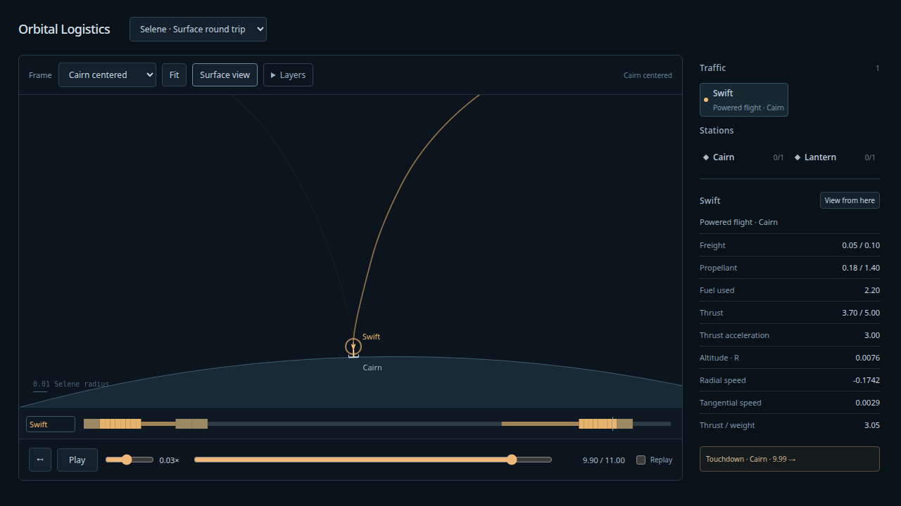
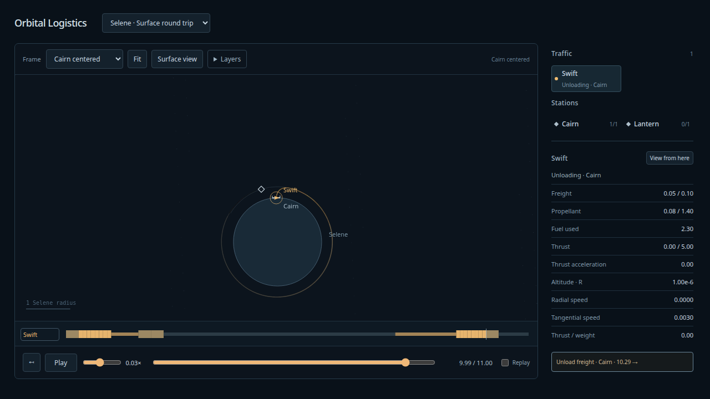

# Airless surface round trip — 2026-10-08

**Selene · Surface round trip** adds the return half of the accepted ascent. Swift
delivers .1 freight from Cairn to Lantern, refuels, loads .05 freight, waits for a
departure window, coasts and brakes through eight finite arcs, lands, unloads and
remains on Cairn. The original one-way set and its outbound program are preserved.
The [Astra review/disposition](../design/surface-landing/README.md) defines capture,
event ordering, resource ownership and drawing admission.

## Verified behavior

- Production build and **115 simulation tests pass**. Dedicated landing tests cover
  inside/outside position and full-speed limits, radial/lateral excess, below-COM
  exterior attachment, small upward residual, positive residual with no fuel,
  locally tightened historical capture tolerance, rejected simultaneous impulses,
  thrust starts/operations, wrong ports/epochs, paid braking followed by failed
  capture, and successful attachment followed by failed service.
- Thrust can end at touchdown: **thrust-end → land → transfer-start**. Capture checks
  precede any attachment/resource/cursor mutation. A failure preserves its input
  free state and resources; completed thrust remains completed and paid. There is
  exactly one landing/berth arrival and no synthetic dock. A small test completes
  post-landing loading/refueling and relaunches with the existing atomic release.
- Irregular queries, backward seeks and snapshots before/at/after touchdown reproduce
  exactly. Retained ascent snapshots from before the change restore, with serialized
  JSON compared at its original representation (JSON normalizes negative zero).
  Original outbound samples remain identical through delivery.
- `npm run evidence:landing`: the same frozen program at **1/512, 1/1024, 1/2048**
  agrees with independent seven-state forward DOP853, discrete service/resources,
  fuel consumption, paid captures and complete event trace. Maximum sampled six-state
  errors are **2.31e-12, 1.58e-13, 7.54e-14**. Tightened-oracle difference is
  **3.31e-13**; finest values reach the oracle/authoring floor. Pre-snap touchdown
  states/resources are compared separately, so analytical attachment cannot hide
  incoming error. Production uses **11,321 canonical nodes**, finest **22,573**,
  below65,536; production retains **3,715 certified free-flight intervals**.
- Production touchdown residuals are **3.41e-12 R / 8.38e-12 speed**; oracle
  **3.38e-12 / 8.33e-12**. Across all resolutions and oracle, each maximum plus
  **1e-8** is below the effective runtime **1e-7** position/speed tolerances and
  content ceiling. Production residual matching consumes **3.16e-12 fuel**; no
  nonzero residual is free. The finite arcs supply the braking.
- Unchanged interval certificates cover both flights. Conservative retained-interval
  clearance lower bound is **5e-7 R**, over1,000 times numerical disagreement.
  DOP853 is an agreement check, not an independent interval safety proof.
- Depart Lantern **t=7.829865669**, begin braking **9.278685119**, land **9.986868695**,
  finish unloading **10.286868695**, horizon11. Swift finishes with **.08 fuel**,
  zero cargo and **2.30259813119 cumulative fuel consumption**. Cairn has .15 cargo/
  .8 fuel/one occupied berth; Lantern .05 cargo/.01740186882 fuel/empty berth.
  Cargo and fuel-plus-consumption are conserved. Lantern's legacy objective is net
  .05 delivery; the round-trip metadata reflects returned fungible freight.
- Full-flight close drawing admission checks **32,760 interior points** (quarter,
  midpoint, three-quarter), exact event-left endpoints and path segments in inertial,
  primary, both port, rotating and ship-centered frames. **13,494 disposable samples**;
  maximum measured discrepancy **9.83e-8 R = .0983 px at1million px/R**, below the
  .25px gate. Flight and total sample budgets reject oversized content. This sampled
  fixture evidence is not a general interpolation proof for arbitrary programs.
- Original ascent independent oracle rerun passes after the shared Python arrival
  branch extension. Ruff format/lint and ty cover the retained authoring tools.
- **16 production Chrome browser tests pass**, with zero captured page/console
  errors. The new case checks braking/whiskers, exact touchdown jump, unloading,
  berth/stocks, unchanged physics across five frame choices, rewind and repeated
  live/one-way/round-trip switching. Existing rolling history, held-head playback,
  retired worker asset and delayed reply regressions remain passing.
- In-app preview4178 was reloaded, inspected at9.9 in Cairn close view, played through
  touchdown/unloading, then rewound and left paused at9.9, **0.03125×**. No captured
  warning/error logs. Hands-on motion/readability taste remains the user's gate.

## Viewing

Select **Selene · Surface round trip**, scrub to **9.9**, click **Surface view**, and
use a slow playback rate. **Touchdown · Cairn** jumps to the exact attachment epoch;
scrub past10.287 to see unloading complete. **Fit**, **Swift centered** and **Surface
rotating** expose the orbital and local approaches. Camera and speed stay under your
control. Replay rewinds this finite scene and its inventories.

## Contract and provenance

`land` is additive to surface-ports-v3; canonical physics/snapshot v3 and initial
surface `dock` semantics are unchanged. Position capture is limited to the lesser
of authored tolerance and one-quarter represented COM clearance; full relative
velocity against the rotating pad is matched using the rocket equation. The existing
COM is supported1e-6R above the sphere. No hull/leg contact, surface collision exemption,
gravity softening, attitude, atmosphere or runtime guidance was added.

The [bounded authoring study](../design/surface-landing/landing-study.py) uses reverse
shooting to find a boundary-value candidate; reverse mass growth is confined to that
offline calculation. Every admitted flight propagates forward and spends fuel.
Only departure window and rotated inertial controls are chosen: existing pad/depot
phases and outbound arcs remain fixed. The fixture is a safe feasible witness, not an
optimal descent or a general landing solver. Finite orbital refueling supplies nearly
all descent fuel and leaves a small positive station reserve.

Retained [oracle inputs](landing-oracle-input.json), [report](landing-oracle-report.json),
[display/resources](landing-display-report.json), snapshots, study and forward probes
support reproduction. `npm run evidence:landing` regenerates complete evidence;
`node --import tsx docs/design/surface-landing/assemble.ts` rebuilds the fixture.
Continuous surface dispatch is the next separate slice. Staging/recovery, maintained
stations, atmosphere and 3D presentation remain later work.
