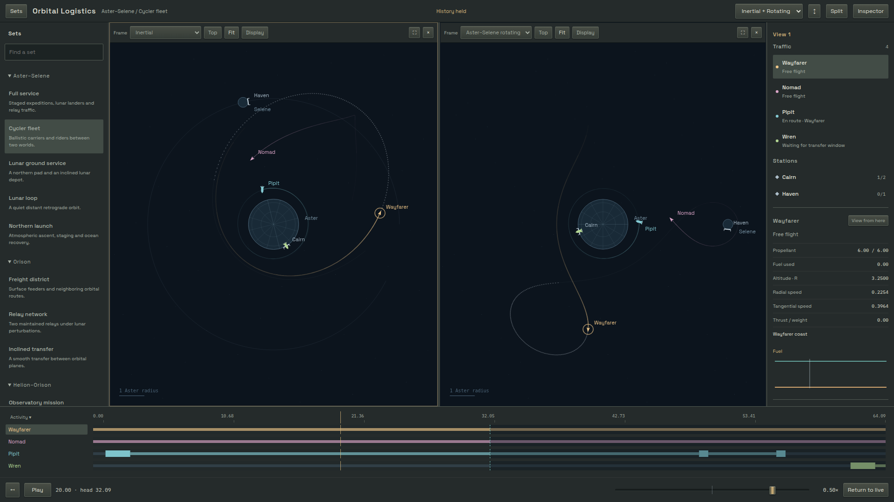

# Docked observation workspace

2026-10-13 client date. Implements steps1–2 of the
[reviewed polish plan](../design/viewer-polish/plan.md). The optional public arrival
page/hero and real-device mobile viewer are subsequent slices.

## Experience

The curated library has eleven exhibits in four systems, with short descriptions
and search. Fully superseded sets have no public registration; a retired/unknown
hash link offers the library instead of silently loading an unrelated composition.
Compiler sources and numerical regression fixtures remain where current services
or tests depend on them. Direct retained links use `#set=<stable-id>` on a static host.

The warm gray-green docked panels use local Space Grotesk and IBM Plex Mono fonts,
restrained beveled controls, and background fills for selected rows. Sets/inspector
collapse. Paths, trail length, appearance and supported dynamics are grouped in
Display. Camera contains orientation, tracking and the deliberate Surface/Entry
preset. About holds provenance rather than repeating it around the scene.

At most two panes share playback. Presets offer overview/chase, inertial/rotating,
and top/front. Divider drag/keys, stacking, maximize/restore, close and duplicate
preserve presentation state. Click/focus activates; pointer traversal and wheel
zoom do not move inspector ownership. Inspection selection is local and does not
retarget a locked Follow/Chase camera. Track selected explicitly replaces its target.

The shared ruler and actor lanes replace the separate scrubber. Names select in
the active pane; plots seek shared time. The player groups textual time, bipolar
speed, Play, restart and Live/finite Replay. Lane collapse leaves the ruler;
resizing uses the dock's top edge. A scrub pins its displayed bounds and restores
prior playing state into held playback on release; paused seeking stays paused.

## Ownership and loading

- `viewer/catalog.ts` contains metadata only. `loaders.ts` separately imports the
  selected definition and large profile URLs. No retired eager entrypoint imports.
- `viewer/session.ts` is the only owner of the preparation/traffic worker, domain
  store, generation/sequence guards, ingestion, bounded outstanding request, held
  resources, playback clock and scene publication. It keeps cursor-dependent
  adapter queries at the existing100ms cadence plus coverage invalidations.
- `viewer/viewport.ts` receives a read-only presentation interface. Each pane owns
  frame, camera, selection, tracking target/offset, layers, label hysteresis,
  projection/hits and potential/relief resources. View changes cannot advance,
  ingest or release the session. Historical path vertices retain their own epochs.
- `viewer/shared.ts` caches frame-independent drawing samples by immutable vessel
  descriptor and epoch. The canonical engine never reads that cache.
- `viewer/workspace.ts` owns active-pane routing, shared panels/timeline, input,
  layout and one RAF. It advances once, updates both visible panes, then paints
  the same publication/time synchronously. Drawing does not select actors/change
  frames/move the clock. Capability failure is applied in the pane update phase.
- `mountWorkspace(host).dispose()` is idempotent: cancel RAF/listeners, invalidate
  pending loading, terminate the sole worker, dispose panes and clear host/probes.
  The minimal entrypoint mounts it; Vite HMR tears it down before replacement.

Foreground backing is limited to~8.3million pixels across visible panes, with DPR
capped at2. Hidden maximized peers shrink their foreground to1×1, stop refinement
and retain their camera. Each pane has the existing16MiB field limit; relief still
caps its longest backing edge at1024. Permanent disposal terminates field workers,
rejects stale callbacks, deletes GL buffers/programs and loses owned GL contexts.
Set reload replaces field canvases before acquiring a new context.

The entry bundle decreased from990580decoded bytes in the planning baseline to
about223kB (~71kB gzip). Preparation and traffic workers are separately cached
~237kB/~339kB chunks. The1.42MB fleet profile and13.31MB Solar profile remain demand
loaded. One build warning remains: the small freight-district definition is also
imported by its existing validator, so that particular definition shares the main
chunk. Per-domain worker splitting/binary history storage/WebGL scene migration
were not justified by this slice's measurements.

## Review and validation

[Astra implementation review and disposition](../design/viewer-polish/implementation-disposition.md)
record the source audit and three corrected findings. gpt-6-astra/high transport
was verified from the read-only CLI log, not self-report.

- Production build/typecheck pass.
- All305 existing numerical tests pass, including historical compiler/physics witnesses; the new indexed-display-window edge/order test also passes.
  Test concurrency is bounded to2 to avoid launching all expensive witnesses at once.
- All12 production workspace tests pass. The workspace suite replaces obsolete single-canvas/retired-set DOM
  tests (retained in Git). It exercises all11 loaders, dual frames, physical-state
  parity, local selection/layers, locked tracking, resize/maximize/close/duplicate,
  keyboard ownership, shared seeking/reverse, held pending replies/Live, one
  simulation worker, canceled loads and foreground pixel accounting.
-20split/relief/close cycles return GL buffer ownership to zero and retain exactly
  one shared simulation worker. Switching/restarting after relief reacquires a
  working context. Worker/buffer counters are exact for those owned resources;
  they are not a complete heap/GPU/process-memory proof.

## Desktop performance

[Raw bounded samples](../design/viewer-polish/workspace-performance.json) and
[reproduction script](../design/viewer-polish/workspace-profile.mjs) record Linux,
Ryzen7 7840U, Chrome155.0.8059.39, headless/DPR1. Other desktop applications were
running; this is a local lab measurement, not field/mobile or hardware-GPU evidence.
The initial architecture baseline has three30-second samples per standard case, before the final explicit-preset fit correction. Finite inclined-transfer scenes
Replay to keep the sample active; full service runs continuously at16×.

| Composition | Frame-gap p95, all three runs | Draw p95 range |
|---|---|---|
|1080p inclined transfer, one pane,1×|16.7–16.8ms|3.8–4.1ms|
|1080p Top+Front, two panes,1×|16.7ms|9.0–9.8ms|
|1080p Top+Front, two panes,16×|16.7–16.8ms|8.9–9.6ms|
|4K full service, inertial+rotating,16×|33.4ms|18.9–19.2ms|
|4K cyclers, paired frames, one relief pane,0.5×|33.4ms|6.8–8.0ms|

The relief case uses three15-second samples during its early history rather than
claiming a30-second full-trail worst-case gate. Chrome uses SwiftShader in this
headless configuration. Full-service publication refresh p95 was5.1–5.4ms and
happens once per session, not per pane. Phase percentiles are not added together.
All samples reported no page exceptions and respected the foreground allocation
policy. The initial cases meet the proposed ordinary≤18ms/heavy≤35ms targets.

The final visual pass corrected fitting before split dimensions had settled. With
both views properly fitted, a follow-up4K sample exposed50ms frame-gap p95 and26ms
draw p95. Indexed trail/future/burn time ranges now avoid scanning unrelated rows;
inertial/rotating projection avoids unused velocity allocations and per-vertex
actor lookup. It retains the same selected sample vertices, boundary membership,
order and each vertex's epoch; the edge/duplicate tests compare the range selector
with the former filter behavior. No physical timestep or trajectory accuracy changes.
[Final30-second spot samples](../design/viewer-polish/workspace-finalspot.json)
returned16.7ms frame-gap /8.2ms draw p95 for1080p two-pane16×, and33.4ms /15.9ms for
4K full service two-pane16× (refresh5.9ms). These final samples were single runs,
not another triple campaign. The earlier50ms finding is retained here rather than
being concealed by the initial baseline.
Input was exercised functionally but no instrumented100ms input-latency percentile
or real-device mobile result is claimed. Higher density, arbitrary camera/relief
combinations and full GPU-process/heap accounting remain outside this gate.

No renderer migration or numerical simplification was needed for this slice.
The static landing/poster/hero boundary remains next, after owner review of the
working layout. Its no-viewer-download/no-worker requirement is not claimed yet.

